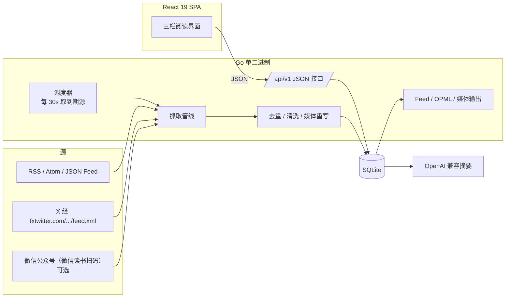

# Rill PDD

> 产品设计文档 / 技术实现方案（Product Design Document）
>
> 版本：0.21 · 日期：2026-11-03 · 状态：设计稿；前端视觉与源管理细化完成，后端 MVP 已交付并完成本地联调；创作者名称搜索与批量订阅已实现核心；LPK v0.1.2 已安装到默认微服，真实浏览器 OIDC 待验收>
> v0.2 变更：合并 PDD v0.1 与两轮评审结论；架构由「单二进制 + `embed` + HTMX」改为**后端 Go 单二进制 + 前端 Vue 3 + Vite 前后端分离**；删除不存在的 `XAdapter`（X 走标准 RSS 适配器）；调度改为落库驱动；补齐数据模型、API 契约、部署与打包约束。产品需求见 [PRD](./PRD.md)，本文不重复功能编号的定义，只在需要时引用 `F-xx`。
>
> v0.3 变更：前端技术由 Vue 3 + Pinia 改为 **React 19 + Vite + TypeScript**，路由改用 React Router，跨组件状态改用 Zustand；样式保持 CSS 变量 + 分层原生 CSS，不引入运行时 CSS-in-JS。新增 `web/` 工程目录与 mock API 约定，前端可在后端未完成时独立开发。PRD 同步更新技术描述。
>
> v0.4 变更：前端接通后补齐 `POST /auth/password`、`POST /settings/feed-token/reset`；全站 Feed/OPML 令牌与单源令牌分离重置；备份恢复使用 multipart 上传，前端由官方 file chooser/文件输入选择。数据模型补入 `folders.parent_id`、`sessions`、`sources.initial_fetched/note/icon_url` 与 `items.original_title`，与 Go 后端实现对齐。
>
> v0.5 变更：条目摘要新增派生字段 `cover_url`（正文前 16KB 的首个 `/media/` 图片，不新增列）；`settings.reader` 新增 `rail_width` / `list_width`，支持拖动栏宽并跨设备保留；前端 localStorage 仅做首屏防跳变。列表仍固定 `sort=published`，已读筛选复用 `unread/read` 参数。
>
> v0.6 变更：详情页操作收敛到顶部工具栏，正文底部不再重复收藏 / 专注 / 外链；桌面翻译改为右上角图标 + 浮层，移动端与专注右栏保留紧凑面板；三点源诊断入口移除，改为点击来源名称进入 `/sources/{id}`。
>
> v0.7 变更：点击未读条目立即乐观已读，直接访问仍由停留观察器 3 秒后标记；详情元信息改为来源 / 时间 / 作者同排；AI 摘要常显；桌面右侧进度轨使用滚动容器实时计算；阅读位置存 `localStorage`（不新增 schema）；前端接入既有 folders CRUD 与 OPML 导入导出端点。
>
> v0.8 变更：SchemaVersion 3。迁移 2 为 `sources` 增加保留天数/条数；迁移 3 建立 `items_fts` FTS5（trigram）与同步触发器；新增受登录保护的源图标代理和全站 token reveal；保留清理与图标缓存的实现事实回填到 §6.5/§9.5/§11。
>
> v0.9 变更：Folder API 增加 `parent_id`，前端支持多级树；3 层 OPML roundtrip 落地；媒体缓存按 `RILL_MEDIA_MAX_BYTES` LRU、图标缓存按 8 MB / 500 文件 LRU；旧 Schema 备份由 `PrepareForRestore` 先迁移到当前版本再恢复。
>
> v0.10 变更：新增懒猫 OIDC 登录（授权码 + PKCE、加密 state cookie、userinfo `sub`、复用 `sessions`/CSRF，无 schema 变更）；密码模式降级为本地开发；LPK V2 清单、构建与运行脚本落地，登录/包图标统一，`rill -health` 供容器健康检查。已安装到默认微服并 healthy；真实浏览器 OIDC 回调待验收。
>
> v0.11 变更：`POST /api/v1/sources` 创建成功后同步抓取一次并回填状态，避免新增源后还要手动刷新；前端添加源改为单输入自动识别 X 链接/用户名与 Feed URL；订阅源设置改为 filetree；阅读列表方形封面与标题同排，阅读进度改环形并分离回到顶部；设置弹窗移除同步状态指示。
>
> v0.12 变更：按用户决策移除 SSRF/内网地址拦截（DEC-015）；出站抓取仅保留 scheme 与凭据校验，`RILL_ALLOW_PRIVATE_NETWORK` 与 `AllowPrivateFetch` 一并删除；§12.1 重写。
>
> v0.13 变更：抓取失败增加重试与备用源自动接管、取消 fail_count≥5 调度冻结（§9.1）；新增 `rsshub://` 链接归一化与 Bluesky 官方 RSS 订阅（§7.2/§7.3）；公众号扫码接入真实 we-mp-rss sidecar 代理（JWT 缓存、二维码 data URL、状态轮询，`/wechat/scan`、`/wechat/scan/status`，sidecar 管理账号存设置、密码加密）；订阅源设置页精简（更多操作菜单、去掉状态筛选行、分组行收敛）。
>
> v0.14 变更：SchemaVersion 4（迁移 4 加 `sources.backfill_mode`）。X / Bluesky 全量历史回补（§7.2 适配器表、§9.1 调度）：X 走 FxTwitter 游标 JSON API（`results` 字段 + `cursor.bottom`，实测每页 20 条、~3200 条平台上限），Bluesky 走公开 AppView `getAuthorFeed`；编辑源弹窗可切「抓取范围 / 窗口条数」，切 full 立即后台回补并写进度到源备注；去重键与窗口抓取一致（DEC-016）。
>
> v0.15 变更：REQ-030 / DEC-020 平台链接与 ID 解析。新增 `POST /api/v1/sources/resolve`：Apple Podcasts 走 iTunes Lookup → `feedUrl`；小宇宙优先 `feed.xyzfm.space`、无 Feed 时页面 SSR 最近 15 条；微博匿名访客态最近最多 100 条；Medium/Mastodon URL 归一化。小宇宙/微博使用 `kind=rss` + `xiaoyuzhou://` / `weibo://` scheme，不改 `sources.kind` CHECK 与 schema；前端部分/多候选先展示限制再确认（§5.2/§7.2/§7.5）。
>
> v0.16 变更：REQ-031 BestBlogs 公众号目录优先解析。`POST /sources/resolve` 对裸公众号名称先查 BestBlogs 公开 OPML（缓存 6h、可配 `RILL_BESTBLOGS_CATALOG_URL`）；命中创建 `kind=rss`，不要求公众号后台登录；`wechat2rss.bestblogs.dev/feed/{40hex}.xml` 直接识别；目录不可用/未命中回退现有公众号后台搜索。仅接受 BestBlogs 固定 host 的 Feed URL，不新增 schema 或源类型（§5.2/§7.5）。
>
> v0.17 变更：REQ-032 BestBlogs 多平台目录。`bestblogs:{名称}` 跨公众号/小宇宙/X/YouTube 公开 OPML 搜索；识别 `wechat2rss.bestblogs.dev`、`rsshub.bestblogs.dev/xiaoyuzhou`、`api.xgo.ing`、YouTube 官方 Feed 四类 URL，统一 `kind=rss`；保留平台优先级（公众号 BestBlogs 优先；小宇宙官方 Feed、X FxTwitter、YouTube 官方 RSS 优先），自动搜索仅限裸中文名，ASCII handle 走平台主路径，目录只作候选/降级；单目录失败 10 分钟后重试；不新增 schema。
>
> v0.18 变更：BUG-001 公众号能力边界修正。2026-07 起微信跨公众号文章列表对非当前后台管理账号返回 `200013`，内置链路只允许抓取 `switchacct` 返回的自有公众号；搜索只返回可管理账号，外部未收录账号拒绝创建并提示 BestBlogs/外部 RSS。同会话抓取串行、请求间隔 1s，200013 触发 30 分钟会话级冷却；不新增 schema。
>
> v0.19 变更：REQ-033 公众号双通道。新增微信读书扫码登录与外部账号采集：fakeid 推导 `MP_WXS_*`，幂等加书架，`/web/mp/articles` 列表、`/api/mp/cover` 兜底最新一篇、`/web/mp/content` 正文；自有账号优先微信后台，`200013`/非自有账号回退微信读书；`-2041` 4h 冷却；Cookie AES-GCM 加密、UID 不返回前端；设置页新增微信读书扫码；已复核 WeRSs 仍走微信后台，不作为核心链路。
>
> v0.20 变更：REQ-034 / DEC-024 公众号收敛为微信读书扫码唯一通道。移除微信后台链路（`switchacct`/`searchbiz`/`appmsgpublish` 与 `wechat_session_enc` 会话）和 we-mp-rss sidecar 伴生服务（`sidecar_url`/`sidecar_username`/`sidecar_password` 设置与 `/wechat/scan`、`/wechat/scan/status`、`/wechat/search`、`/wechat/accounts`、`/wechat/logout` 端点）；`wechat://<fakeid>` 源统一走微信读书抓取；`/wechat/resolve` 改为公开文章页提取 `biz`，创建源要求微信读书已连接；设置 `/settings` 的 wechat 段只剩 `enabled` + `weread_connected`；微信读书扫码成功即刷新设置并提示；不新增 schema（§5.2/§7.4/§7.5）。
>
> v0.21 变更：REQ-035 创作者名称搜索与批量订阅。新增 `POST /api/v1/sources/search`，用 searcher 并发查询 Apple Podcasts、Bluesky searchActors、微博精确昵称和 BestBlogs 四目录；返回候选 + 平台 `ok/empty/error/timeout` 状态，总超时 8s、单平台 5s，缓存 10 分钟（失败 1 分钟），缓存不保存已订阅标记；新增 `POST /api/v1/sources/batch`，最多 20 项、按 Feed URL 去重，创建后后台首次抓取，避免批量请求长期阻塞。前端添加源增加「搜索创作者」模式、平台分组、多选和批量订阅；不新增 schema、源类型或外部凭据（§5.2/§6.5/§7.6）。
> v0.22 变更：2026-11-08 微博渠道移除（DEC-026）。删除 `weibo.go` 抓取器、resolve 微博解析与创作者搜索微博平台；迁移 6（SchemaVersion 6）停用存量 `weibo://user/%` 源并标注，文章数据保留；粘贴微博链接/UID 返回「微博渠道已移除」。同批：扫码成功后清除公众号源「需重新扫码」残留状态并把刷新提前（`recoverWechatSources`）；默认首次回溯 `initial_limit` 20→100；候选头像代理（v0.22 前的 11-08 增补已并入本版）。；抓取失败一律先尝试 wr_rt 续期再重试一次（过期会话可能表现为 HTML 登录页/解析失败，不能只盯 auth 错误）；`/settings` wechat 段新增 `weread_can_renew`，设置页对无法续期的登录凭据给出重新扫码提示；前端源状态最近一次抓取失败不再显示「正常」。

> v0.23 变更（2026-11-10，REQ-036/037，DEC-027 已确认）：迁移 7/8（SchemaVersion 8）新增 `push_channels` / `digest_rules` / `digest_reports` / `filter_rules` 与 `items.hidden` 列，迁移 8 为 `push_channels` 补 `secret_enc`（飞书签名校验密钥，选填；首个 v0.1.3 包已把微服升到 schema 7，修订迁移 7 不会重跑，故以迁移 8 补列）。定时报告：规则按周期汇总指定源窗口内条目，AI 分批小结后合并为 Markdown 报告落库，AI 失败/未启用降级为列表报告；推送渠道可配置（飞书 webhook 卡片、自定义 webhook JSON），webhook URL 经 SecretBox AES-GCM 加密落库、API 只返回打码形式；报告可手动重推。过滤规则：新条目入库后按源评估，动作 `mark_read` / `hide`（`items.hidden=1`），支持应用到存量、命中计数与「已过滤」视图恢复；报告生成跳过隐藏条目；不做相似文章聚合（用户明确不纳入）。
> v0.24 修正（2026-11-10，REQ-036，DEC-028）：迁移 9（SchemaVersion 9）为 `digest_rules` 补 `channel_ids_json`，修复前端勾选渠道被后端忽略、实际推送到所有启用渠道的问题；存量规则回填为当前全部启用渠道。报告调度按 `RILL_TIMEZONE`（默认 `Asia/Shanghai`）解释 `run_at_local`，`next_run_at` 统一落 UTC 绝对时间，修复容器 UTC 时「设置 11:52 却显示 19:52」；启动时修复旧规则的错位 `next_run_at`。AI 提示词改为极简简报（900-1400 字、每批要点 ≤40 字），飞书推送去掉完整文章清单并保留 Rill 内查看提示；飞书 HTTP 200 + 业务错误码也判为推送失败。
>
> v0.25 变更（2026-11-11，REQ-038，DEC-029）：迁移 10（SchemaVersion 10）新增 `mcp_tokens`；设置新增 MCP 开关与多命名 Bearer Token；`/mcp` 使用 MCP Streamable HTTP（SSE），加入 LPK `public_path`，工具覆盖读取与写入但不提供删除，也不暴露密钥/设置/备份恢复；新增 `GET /api/v1/items/{id}/markdown` 与前端复制/下载（blob 锚点接入懒猫 file-chooser inject）。
>
> v0.26 变更（2026-11-12，REQ-039）：迁移 11（SchemaVersion 11）新增 `items.later_at` 与 `item_notes`；条目查询/统计/状态支持 `later`，新增笔记 CRUD；`OPML export/import` 支持 `folder_id` 子树范围；`sources.config_json.full_text` 控制每源全文抓取；侧栏批量/搜索/保存视图、列表多选与跨源重复合并、命令面板、浏览器朗读；MCP 增加 `move_source`/`move_sources`/`reorder_folders`，仍不提供删除。

---

## 1. 设计原则

1. **后端单二进制**：Go 编译产物，不引入 Node/Python 运行时。前端是独立构建产物，构建期需要 Node，运行期不需要。
2. **源适配器隔离**：任何第三方源的问题不能污染主流程。适配器 panic 必须被 recover 并记为该源失败（见 §9.6）。
3. **能力边界显式化**：需要登录的源、依赖第三方的源，在 UI 和文档里都标注清楚。
4. **默认安全**：出站抓取只做 scheme 与凭据校验（2026-11-01 起不再拦截私网，见 §12.1 与 DEC-015）；Feed 内容默认清洗。
5. **可降级**：X 源可在主源与备用源之间切换；公众号源可整体关闭。
6. **数据可迁移**：SQLite 单文件 + OPML 导出，不锁定用户。
7. **调度状态落库**：进程重启即恢复，不依赖内存定时器。

## 2. 总体架构



### 2.1 运行形态

- 单个 Go 进程提供 JSON API + 静态前端 + 抓取调度。
- 前端：React 19 + Vite 构建出的 `dist`，默认由 Go 进程以文件系统静态托管（同源部署，见 §6.3）。
- SQLite 单文件数据库（纯 Go 驱动，无 CGO）。
- 可选微信读书扫码登录：仅公众号采集需要。
- 运行时数据在 `/lzcapp/var/data`（含备份目录），媒体与图标缓存在 `/lzcapp/cache/rill`；运行时**不写** `/lzcapp/pkg/content`。

## 3. 技术选型

| 层 | 选择 | 理由 |
| --- | --- | --- |
| 后端语言 | Go 1.23+ | 单二进制、低内存、交叉编译简单 |
| HTTP | 标准库 `net/http` | 足够，减少依赖 |
| 路由 | 标准库 `ServeMux`（优先）/ `chi` | 需要中间件链时再引入 chi |
| Feed 解析 | `github.com/mmcdole/gofeed` | README 明确覆盖 RSS 0.90–2.0、Atom 0.3/1.0、JSON Feed 1.0/1.1 |
| HTML 清洗 | `github.com/microcosm-cc/bluemonday` | 成熟、策略可配置 |
| 字符集 | `golang.org/x/net/html/charset` | 处理 GBK/GB18030 源站 |
| SQLite | `modernc.org/sqlite` | 纯 Go、无 CGO，交叉编译友好 |
| 调度 | `next_fetch_at` 落库 + 30s 轮询 | 不依赖内存定时器；重启即恢复 |
| 日志 | 标准库 `log/slog` | 结构化 JSON 日志 |
| 配置 | 环境变量 + 可选 YAML | 与 LPK 注入方式兼容 |
| 后端测试 | 标准库 `testing` + `httptest` | 无额外框架 |
| 前端框架 | React 19（函数组件 + hooks） | 阅读器需要大量局部状态与列表复用；组件边界清晰，生态成熟 |
| 前端语言 | TypeScript（`strict`） | 与后端契约强绑定，字段写错在编译期暴露 |
| 前端构建 | Vite 8 | dev server + HMR，产物带 hash |
| 前端路由 | React Router 7（history 模式） | 需要服务端 SPA fallback（§6.3） |
| 前端状态 | Zustand 5 | 只放跨组件状态（auth / 源树 / 筛选 / 阅读偏好） |
| 前端样式 | CSS 变量 + 分层原生 CSS | 暗色模式与阅读排版靠变量切换；不引入运行时 CSS-in-JS |
| 前端测试 | Vitest 5 + React Testing Library + jsdom；Playwright 可选 | 键盘导航、无限加载、阅读设置必须有组件级测试 |
| HTML 清洗 | DOMPurify（前端双保险） | 后端已清洗；前端渲染前再走一次白名单 |

> 前端依赖版本由 `package.json` + 锁文件固定，CI 与本地必须同一 Node 版本（建议 22 LTS）。Go 与 Node 只在构建期同时存在，运行镜像只有二进制 + `dist`。

## 4. 数据模型

### 4.1 初始化 PRAGMA

每条连接必须执行（`modernc.org/sqlite` 的 DSN 或 `OnConnector` 均需覆盖）：

```sql
PRAGMA journal_mode = WAL;      -- 页面读不阻塞抓取写
PRAGMA synchronous = NORMAL;
PRAGMA foreign_keys = ON;       -- 不开启则 ON DELETE CASCADE 静默失效
PRAGMA busy_timeout = 5000;
```

写入走单写者：`db.SetMaxOpenConns(1)`（单用户单进程场景下最省心），或显式单写 goroutine + 队列。抓取入库按源分批事务，单个源失败只回滚它自己。

### 4.2 表结构

```sql
CREATE TABLE folders (
    id          INTEGER PRIMARY KEY,
    name        TEXT NOT NULL,
    sort        INTEGER NOT NULL DEFAULT 0,
    parent_id   INTEGER REFERENCES folders(id) ON DELETE SET NULL,  -- OPML 嵌套
    created_at  TEXT NOT NULL
);
CREATE INDEX idx_folders_parent ON folders(parent_id, sort);

CREATE TABLE sources (
    id               INTEGER PRIMARY KEY,
    kind             TEXT NOT NULL,                    -- rss | x | wechat；小宇宙/微博用 rss + 自定义 scheme
    name             TEXT NOT NULL,
    feed_url         TEXT NOT NULL,
    site_url         TEXT,
    folder_id        INTEGER REFERENCES folders(id) ON DELETE SET NULL,
    config_json      TEXT NOT NULL DEFAULT '{}',       -- 源类型专属配置
    enabled          INTEGER NOT NULL DEFAULT 1,
    refresh_seconds  INTEGER NOT NULL DEFAULT 1800,
    initial_limit    INTEGER NOT NULL DEFAULT 20,      -- 首次回溯上限，1..100
    initial_fetched  INTEGER NOT NULL DEFAULT 0,       -- 首次回溯是否完成
    fallback_url     TEXT,                             -- 备用源
    etag             TEXT,
    last_modified    TEXT,
    next_fetch_at    TEXT NOT NULL,                    -- 调度依据
    last_fetch_at    TEXT,
    last_new_item_at TEXT,                             -- 静默失败检测
    last_status      TEXT,                             -- ok | not_modified | error
    last_error       TEXT,
    fail_count       INTEGER NOT NULL DEFAULT 0,
    note             TEXT,                             -- 源状态的可读说明
    retention_days      INTEGER NOT NULL DEFAULT 0,   -- 迁移 2；0=不限，只清理已读未收藏
    retention_max_items INTEGER NOT NULL DEFAULT 0,   -- 迁移 2；0=不限
    icon_url         TEXT,                             -- Feed 提供的远端图标地址；API 不直接暴露
    feed_token       TEXT NOT NULL UNIQUE,             -- Feed 输出鉴权，可重置
    created_at       TEXT NOT NULL,
    updated_at       TEXT NOT NULL
);

CREATE INDEX idx_sources_due ON sources(enabled, next_fetch_at);
CREATE INDEX idx_sources_folder ON sources(folder_id, name);
CREATE INDEX idx_sources_feed_token ON sources(feed_token);

CREATE TABLE items (
    id                      INTEGER PRIMARY KEY,
    source_id               INTEGER NOT NULL REFERENCES sources(id) ON DELETE CASCADE,
    guid                    TEXT NOT NULL,
    url                     TEXT,
    title                   TEXT,
    original_title          TEXT,                      -- 标题本地化前的原文
    author                  TEXT,
    published_at            TEXT,                      -- RFC3339 UTC 归一化值
    published_raw           TEXT,                      -- 原始字符串，排障用
    published_estimated     INTEGER NOT NULL DEFAULT 0,-- 1 = 用抓取时间兜底
    content_html            TEXT,
    content_text            TEXT,
    media_json              TEXT,                      -- {"images":[...],"audio_url":"...","audio_type":"..."}；旧行为字符串数组
    content_hash            TEXT,
    read_at                 TEXT,                      -- 单用户，直接放本表
    starred_at              TEXT,
    fetched_at              TEXT NOT NULL,
    updated_at              TEXT NOT NULL,
    UNIQUE(source_id, guid)
);

CREATE INDEX idx_items_source_published ON items(source_id, published_at DESC);
CREATE INDEX idx_items_published ON items(published_at DESC, id DESC);
CREATE INDEX idx_items_fetched ON items(fetched_at DESC, id DESC);
CREATE INDEX idx_items_unread ON items(source_id, published_at DESC) WHERE read_at IS NULL;
CREATE INDEX idx_items_starred ON items(starred_at) WHERE starred_at IS NOT NULL;
CREATE INDEX idx_items_content_hash ON items(content_hash);
CREATE INDEX idx_items_retention ON items(source_id, COALESCE(published_at, fetched_at));

-- 迁移 5：播客播放进度（单用户，按条目一条记录）
CREATE TABLE podcast_progress (
    item_id           INTEGER PRIMARY KEY REFERENCES items(id) ON DELETE CASCADE,
    position_seconds  REAL NOT NULL DEFAULT 0,
    duration_seconds  REAL NOT NULL DEFAULT 0,
    updated_at        TEXT NOT NULL
);

-- 迁移 7（REQ-036，DEC-027）：推送渠道；URL 属凭据，SecretBox AES-GCM 加密
CREATE TABLE push_channels (
    id          INTEGER PRIMARY KEY,
    name        TEXT NOT NULL,
    kind        TEXT NOT NULL CHECK (kind IN ('feishu','generic_webhook')),
    url_enc     TEXT NOT NULL,                     -- SecretBox 密文；API 只返回打码形式
    enabled     INTEGER NOT NULL DEFAULT 1,
    created_at  TEXT NOT NULL,
    updated_at  TEXT NOT NULL
);

-- 迁移 7：报告规则；scope_json 为源 id / folder:<id> 数组，空数组 = 全部源
-- 迁移 9：channel_ids_json 为勾选的推送渠道 id 数组，空数组 = 不推送
CREATE TABLE digest_rules (
    id            INTEGER PRIMARY KEY,
    name          TEXT NOT NULL,
    scope_json    TEXT NOT NULL DEFAULT '[]',
    channel_ids_json TEXT NOT NULL DEFAULT '[]',
    period        TEXT NOT NULL CHECK (period IN ('daily','weekly')),
    run_at_local  TEXT NOT NULL DEFAULT '09:00',   -- 本地 HH:MM
    weekday       INTEGER NOT NULL DEFAULT 1,      -- weekly 用，1=周一…7=周日
    only_unread   INTEGER NOT NULL DEFAULT 0,      -- 1 = 报告只含未读条目
    push_when_empty INTEGER NOT NULL DEFAULT 0,    -- 1 = 空窗口也生成并推送
    enabled       INTEGER NOT NULL DEFAULT 1,
    last_run_at   TEXT,
    next_run_at   TEXT,
    created_at    TEXT NOT NULL,
    updated_at    TEXT NOT NULL
);

CREATE INDEX idx_digest_rules_due ON digest_rules(enabled, next_run_at);

-- 迁移 7：报告正文与推送结果
CREATE TABLE digest_reports (
    id            INTEGER PRIMARY KEY,
    rule_id       INTEGER NOT NULL REFERENCES digest_rules(id) ON DELETE CASCADE,
    period_start  TEXT NOT NULL,
    period_end    TEXT NOT NULL,
    item_count    INTEGER NOT NULL DEFAULT 0,
    status        TEXT NOT NULL CHECK (status IN ('ok','empty','partial','error')),
    content_md    TEXT NOT NULL,
    model         TEXT,                             -- 生成用模型；列表降级为 NULL
    push_status   TEXT NOT NULL CHECK (push_status IN ('none','ok','failed','partial')),
    push_error    TEXT,
    pushed_at     TEXT,
    created_at    TEXT NOT NULL
);

CREATE INDEX idx_digest_reports_rule ON digest_reports(rule_id, created_at DESC);

-- 迁移 7（REQ-037）：过滤规则；scope_json 为 JSON 数组，空 = 全部源
CREATE TABLE filter_rules (
    id           INTEGER PRIMARY KEY,
    name         TEXT NOT NULL,
    pattern      TEXT NOT NULL,
    is_regex     INTEGER NOT NULL DEFAULT 0,
    match_field  TEXT NOT NULL DEFAULT 'any' CHECK (match_field IN ('title','content','any')),
    action       TEXT NOT NULL CHECK (action IN ('mark_read','hide')),
    scope_json   TEXT NOT NULL DEFAULT '[]',
    enabled      INTEGER NOT NULL DEFAULT 1,
    hit_count    INTEGER NOT NULL DEFAULT 0,
    created_at   TEXT NOT NULL,
    updated_at   TEXT NOT NULL
);

-- 迁移 7 同时：ALTER TABLE items ADD COLUMN hidden INTEGER NOT NULL DEFAULT 0;
-- 隐藏条目默认列表与报告不显示，可在「已过滤」视图查看/恢复；不做相似文章聚合。

-- 迁移 3：独立 FTS5 表，rowid = items.id；触发器同步 title/content_text/author
CREATE VIRTUAL TABLE items_fts USING fts5(title, content_text, author, tokenize='trigram');

CREATE TABLE fetch_logs (
    id           INTEGER PRIMARY KEY,
    source_id    INTEGER NOT NULL REFERENCES sources(id) ON DELETE CASCADE,
    started_at   TEXT NOT NULL,
    duration_ms  INTEGER,
    http_status  INTEGER,
    result       TEXT NOT NULL,                        -- ok | not_modified | error
    item_count   INTEGER NOT NULL DEFAULT 0,
    new_count    INTEGER NOT NULL DEFAULT 0,
    error        TEXT
);

CREATE INDEX idx_fetch_logs_source ON fetch_logs(source_id, started_at DESC);

CREATE TABLE media_cache (
    id              INTEGER PRIMARY KEY,
    url_hash        TEXT NOT NULL UNIQUE,              -- SHA-256(原始 URL)
    source_url      TEXT NOT NULL,
    local_path      TEXT,
    content_type    TEXT,
    size_bytes      INTEGER,
    status          TEXT NOT NULL,                     -- pending | ok | failed
    fail_count      INTEGER NOT NULL DEFAULT 0,
    fetched_at      TEXT,
    last_access_at  TEXT NOT NULL
);

CREATE TABLE ai_results (
    item_id     INTEGER NOT NULL REFERENCES items(id) ON DELETE CASCADE,
    kind        TEXT NOT NULL,                         -- summary | translation | tags
    model       TEXT,
    content     TEXT,
    tokens      INTEGER,
    created_at  TEXT NOT NULL,
    PRIMARY KEY (item_id, kind)
);

CREATE TABLE settings (
    key         TEXT PRIMARY KEY,
    value       TEXT NOT NULL,
    updated_at  TEXT NOT NULL
);

CREATE TABLE sessions (
    token_hash   TEXT PRIMARY KEY,
    csrf_token   TEXT NOT NULL,
    created_at   TEXT NOT NULL,
    expires_at   TEXT NOT NULL
);
CREATE INDEX idx_sessions_expires ON sessions(expires_at);

-- 迁移 10（REQ-038 / DEC-029）：MCP 命名访问令牌。只存 SHA-256 哈希与打码值，
-- 完整令牌只在创建响应返回一次。
CREATE TABLE mcp_tokens (
    id           INTEGER PRIMARY KEY,
    name         TEXT NOT NULL,
    masked       TEXT NOT NULL,
    token_hash   TEXT NOT NULL UNIQUE,
    enabled      INTEGER NOT NULL DEFAULT 1,
    created_at   TEXT NOT NULL,
    last_used_at TEXT
);
CREATE INDEX idx_mcp_tokens_hash ON mcp_tokens(token_hash);

-- 迁移 11（REQ-039，2026-11-12）：稍后读与笔记/高亮。
ALTER TABLE items ADD COLUMN later_at TEXT;
CREATE INDEX idx_items_later ON items(later_at) WHERE later_at IS NOT NULL;
CREATE TABLE item_notes (
    id         INTEGER PRIMARY KEY,
    item_id    INTEGER NOT NULL REFERENCES items(id) ON DELETE CASCADE,
    quote      TEXT NOT NULL DEFAULT '',
    note       TEXT NOT NULL DEFAULT '',
    color      TEXT NOT NULL DEFAULT 'yellow' CHECK (color IN ('yellow', 'green', 'blue', 'pink')),
    created_at TEXT NOT NULL,
    updated_at TEXT NOT NULL
);
CREATE INDEX idx_item_notes_item ON item_notes(item_id, created_at);
```

条目封面不新增列：列表查询只取 `content_html` 前 16KB，提取首个 `/media/` 图片路径作为 `cover_url` 返回；无图返回 `null`。若后续封面准确率或列表负载成为瓶颈，再按数据决策关卡评估显式 `cover_url` 列。

### 4.3 设计说明

- `sources.config_json` 存源类型专属字段，避免为每种源加列；当前未使用，为后续源保留。
- 无 `cursor` 字段：v1 的源全部是「取最近 N 条 + 本地 `guid` 去重」，不存在增量游标。将来接分页型 API 源时再加，不要在字段里留无使用者的空位。
- `items.guid` 是去重主键：RSS 用 `guid`/`id`，退回 `link`，再退回 `sha256(title + published_at_raw + content_text)`。
- 已读/收藏直接放 `items`：单用户没有写热点，`LEFT JOIN` 会让「只看未读」在 10 万条下走不到部分索引。
- `media_cache.status` 区分「未缓存」与「下载失败」，`fail_count` 支持失败退避。
- 时间字段一律 TEXT 存 RFC3339 UTC；备份、比较、排序都基于归一化值。
- 迁移：`PRAGMA user_version` 递增 + 迁移数组（`[]migration{version, sql}`），启动时若版本落后先 `VACUUM INTO` 一份旧库再迁移。当前版本 10：2 加保留字段/索引，3 建 FTS5 并回填旧条目，4 加 `sources.backfill_mode`，5 建 `podcast_progress`，6 停用微博源，7 建 `push_channels`/`digest_rules`/`digest_reports`/`filter_rules` 与 `items.hidden`，8 补 `push_channels.secret_enc`（飞书签名密钥；首个 v0.1.3 已把部分库升到 schema 7，修订迁移 7 不会重跑，故以迁移 8 补列），9 补 `digest_rules.channel_ids_json`，10 建 `mcp_tokens`。

### 4.4 关键 upsert

写入不能覆盖阅读状态，`content_hash` 未变时不更新正文：

```sql
INSERT INTO items (source_id, guid, url, title, author, published_at, published_raw,
                   content_html, content_text, content_hash, fetched_at, updated_at)
VALUES (?, ?, ?, ?, ?, ?, ?, ?, ?, ?, ?, ?)
ON CONFLICT(source_id, guid) DO UPDATE SET
  title        = excluded.title,
  content_html = excluded.content_html,
  content_text = excluded.content_text,
  media_json   = excluded.media_json,
  content_hash = excluded.content_hash,
  updated_at   = excluded.updated_at
WHERE items.content_hash <> excluded.content_hash;
```

## 5. API 契约

### 5.1 约定

- 统一前缀 `/api/v1`，便于破坏性升级。
- 分页统一 cursor（`published_at` + `id` 组合编码），不用 offset；响应带 `next_cursor`，前端无限加载直接消费。
- 时间一律 RFC3339 UTC 字符串；需要排障时另给 `published_at_raw`。
- 错误体固定：`{"error":{"code":"...","message":"...","details":...}}`。前端按 `code` 分支，不解析 `message`。
- 鉴权：`session` cookie（HttpOnly / Secure / `SameSite=Lax`）+ 写操作 `X-CSRF-Token`；CSRF token 由登录响应或 `GET /api/v1/auth/csrf` 下发。
- 管理接口一律 JSON；公开接口（`/feed`、`/opml`、`/media`、`/healthz`）不返回任何源配置。
- 契约可校验：后端注解生成 `openapi.yaml`，前端用 `openapi-typescript` 生成类型；最低限度手写 `src/api/types.ts` 并加契约测试。

### 5.2 接口清单

```text
POST   /api/v1/auth/login              # {password} → session + csrf
POST   /api/v1/auth/logout
POST   /api/v1/auth/password           # {current_password, new_password}
GET    /api/v1/auth/csrf

GET    /api/v1/folders                 # 含每个文件夹下源的数量
POST   /api/v1/folders
PATCH  /api/v1/folders/{id}             # {name?, parent_id?, sort?}；拖拽排序写 sort
DELETE /api/v1/folders/{id}            # 源回落到未分组，不级联删源

GET    /api/v1/sources?folder_id=
POST   /api/v1/sources                 # {url} 或 {kind:"x", handle}；创建后同步抓取一次
GET    /api/v1/sources/{id}            # 源详情 + 健康状态 + Feed 路径（前端诊断页）
PATCH  /api/v1/sources/{id}
DELETE /api/v1/sources/{id}
POST   /api/v1/sources/{id}/fetch      # 手动刷新
POST   /api/v1/sources/{id}/fallback   # 切换备用源抓取一次
POST   /api/v1/sources/{id}/token/reset
GET    /api/v1/sources/{id}/logs?limit=50
GET    /api/v1/sources/{id}/icon       # 受登录保护的源图标代理，缓存到 cache/icons/<id>
POST   /api/v1/sources/discover        # {url} → 发现的 feed 候选
POST   /api/v1/sources/resolve         # {input} → 平台候选（BestBlogs 多平台/Apple/小宇宙/Medium/Mastodon；微博已移除）
POST   /api/v1/sources/search          # {query, platforms?} → 创作者候选 + 各平台搜索状态
POST   /api/v1/sources/batch           # {sources:[SourceInput]} → 批量创建，后台首次抓取
POST   /api/v1/sources/batch-update    # {ids, folder_id?（0=不分组）, enabled?} → 批量移动分组/启停（2026-11-10）
POST   /api/v1/sources/batch-delete    # {ids} → 批量删除，级联清理条目；返回 deleted/missing（2026-11-10）

GET    /api/v1/items?folder_id=&source_id=&unread=1&starred=1&later=1&q=&cursor=
GET    /api/v1/items/stats             # {total, unread, starred, read, hidden, later}
GET    /api/v1/items/{id}
GET    /api/v1/items/{id}/markdown     # 原文 Markdown 导出（session 保护，attachment）
POST   /api/v1/items/{id}/fulltext     # 按当前文章即时抓取原文正文，返回更新后的详情
PATCH  /api/v1/items/{id}/state        # {read?, starred?, later?, hidden?}
GET    /api/v1/items/{id}/notes        # 笔记/高亮列表（session 保护）
POST   /api/v1/items/{id}/notes        # {quote, note, color}
PATCH  /api/v1/items/{id}/notes/{note_id}
DELETE /api/v1/items/{id}/notes/{note_id}
PUT    /api/v1/items/{id}/podcast-progress  # {position_seconds, duration_seconds}，204
PATCH  /api/v1/items/state             # 批量：{ids:[...], read?, starred?, later?, hidden?}
POST   /api/v1/items/mark-all-read     # {source_id?} 或 {folder_id?}（folder 含子树）
POST   /api/v1/items/{id}/summary      # AI 摘要，返回完整结果（兼容）
POST   /api/v1/items/{id}/summary/stream      # AI 摘要，SSE 流式（delta/done/error）
POST   /api/v1/items/{id}/translation  # AI 翻译，返回完整结果（兼容，?force=1 跳过缓存）
POST   /api/v1/items/{id}/translation/stream  # AI 翻译，SSE（title/segment/progress/done/error，?force=1 跳过缓存）

GET    /api/v1/search?q=&cursor=
GET    /api/v1/settings
PATCH  /api/v1/settings
POST   /api/v1/settings/ai/test        # 测试 OpenAI 兼容接口连通性
POST   /api/v1/settings/feed-token/reset  # 重置全站聚合 Feed / OPML 输出令牌
POST   /api/v1/settings/feed-token/reveal # CSRF 保护，按需返回完整 token；no-store
POST   /api/v1/wechat/weread/scan      # 微信读书扫码：生成二维码，UID 不返回前端
GET    /api/v1/wechat/weread/scan/status # 轮询微信读书确认状态；成功 Cookie 加密落库并置 weread_connected
POST   /api/v1/wechat/resolve          # 公开文章页解析公众号 fakeid/name（无需后台登录）
POST   /api/v1/wechat/sources          # 创建 wechat://<fakeid> 源，要求微信读书已连接
POST   /api/v1/backup                  # 立即备份（写 backups/）
GET    /api/v1/backup/download         # 下载备份文件（attachment，2026-11-02）
POST   /api/v1/backup/restore          # 从备份恢复（文件由前端 file chooser 选择）

GET    /api/v1/channels                # 推送渠道列表（url 打码；has_secret 标记是否已配飞书签名密钥）
POST   /api/v1/channels                # 新建渠道 {name, kind, url, secret?}（secret 仅飞书签名校验需要，选填）
PUT    /api/v1/channels/{id}           # 更新；url 留空不改动；kind 省略不变；secret 省略=不变、空串=清除；enabled 可选
DELETE /api/v1/channels/{id}
POST   /api/v1/channels/{id}/test      # 发送测试消息

GET    /api/v1/digest/rules            # 报告规则列表
POST   /api/v1/digest/rules
PUT    /api/v1/digest/rules/{id}
DELETE /api/v1/digest/rules/{id}
POST   /api/v1/digest/rules/{id}/run   # 手动生成一次报告（不影响 next_run_at）
GET    /api/v1/digest/reports?rule_id=&limit=
GET    /api/v1/digest/reports/{id}
POST   /api/v1/digest/reports/{id}/push   # 重推到规则勾选的渠道

GET    /api/v1/filters/rules           # 过滤规则列表（含 hit_count）
POST   /api/v1/filters/rules
PUT    /api/v1/filters/rules/{id}
DELETE /api/v1/filters/rules/{id}
POST   /api/v1/filters/rules/{id}/apply   # 应用到范围内存量条目（已读/收藏不回退）
GET    /api/v1/items?hidden=1          # 已过滤视图；默认列表排除 hidden=1

GET    /api/v1/mcp/tokens              # MCP 命名令牌列表（只含打码值）
POST   /api/v1/mcp/tokens              # {name} → 完整 token 仅本次响应返回
PATCH  /api/v1/mcp/tokens/{id}         # {name?, enabled?}
DELETE /api/v1/mcp/tokens/{id}         # 吊销令牌

GET    /api/v1/opml/export?folder_id=   # 省略 = 全部；指定 = 该分组及子树
POST   /api/v1/opml/import?folder_id=   # 省略 = 根；指定 = 导入到该分组下

GET    /api/v1/healthz
```

- `POST /api/v1/sources` 创建成功后立即同步抓取一次（20 秒上限）；抓取失败只写回源错误状态，不回滚已创建的源。测试通过 `Options.DisableInitialFetch` 关闭该行为。
- 订阅源的 `config_json` 目前只保存 `full_text`（布尔）；`Source.full_text` 由后端解析后返回，前端编辑源时写回 `PATCH /sources/{id}`，不新增列。
- 前端添加源单输入自动识别：X 主页链接 / `@用户名` / 无点用户名 → `{kind:"x", handle}`；Bluesky 主页链接 / `@含点域名handle` → 官方 RSS `{kind:"rss", feed_url:"https://bsky.app/profile/{handle}/rss"}`；`rsshub://` 分享链接由后端归一化；其他 URL 先 `POST /sources/resolve` 识别平台，未识别再走 `POST /sources/discover`，单候选直接创建，多候选由用户选择，discover 失败时按原 URL 兜底创建。
- `POST /sources/resolve` 识别 BestBlogs 多平台目录 / Apple Podcasts / 小宇宙 / 微博 / Medium / Mastodon；公众号裸名称先查 BestBlogs，`bestblogs:{名称}` 跨公众号/小宇宙/X/YouTube 搜索；命中直接创建 `kind=rss`，未命中/目录不可用回退公众号后台（仅当前后台管理账号）。平台解析失败返回明确错误，不回退成「把主页当 RSS」。候选含 `platform/kind/name/feed_url/site_url/icon_url/note/partial`。2026-11-08 增补：候选另含 `icon_proxy_url`，指向 `GET /api/v1/media/candidate/{hash}` 服务端代理出图——微博 `sinaimg.cn` 对外站 Referer 一律 403，浏览器直连候选头像必裂；代理只允许 resolve/搜索预先登记进 `media_cache` 的 URL，未登记 hash 一律 404；`icon_url` 保持原始 URL，仍是创建源落库的值。
- `POST /sources/search` 是名称搜索，不是链接解析：`query` 必填（≤80 字），`platforms` 可省略（默认全部，支持 `apple/bluesky/weibo/bestblogs`）。候选含 `platform/kind/name/handle/feed_url/site_url/icon_url/icon_proxy_url/note/match/source/partial/existing_source_id`；平台状态含 `ok/empty/error/timeout`。并行执行、失败隔离，候选按 Feed URL 去重，原生结果优先于 BestBlogs 目录。已订阅标记按当前 `sources.feed_url` 每次重算，不写入缓存。
- `POST /sources/batch` 接收 `sources: SourceInput[]`，单次最多 20 个；已存在/批内重复的 Feed URL 返回逐项错误，不重复创建。创建成功后立即返回，后台按 20 秒上限执行首次抓取；`full` 回补仍走既有 `startBackfill`。`DisableInitialFetch` 在该路径同样生效。
- `GET /items/{id}/markdown` 返回 `text/markdown; charset=utf-8` 与 `Content-Disposition: attachment`；内容固定为原文（标题、来源、作者、发布时间、原文链接 + 正文），不随译文模式变化；正文 HTML 为空时回退 `content_text`。
- `mcp_tokens` 只保存 SHA-256 哈希和打码值；创建响应返回一次完整 `rill_mcp_...` 令牌，之后只能吊销或重新生成。`/mcp` 是独立公开路径，但每次请求都要求 `Authorization: Bearer <token>`；MCP 总开关关闭时返回 404。

公开输出（不走 session）：

```text
GET /feed/{id}/{token}.xml     RSS 2.0
GET /feed/{id}/{token}.atom    Atom 1.0
GET /feed/{id}/{token}.json    JSON Feed 1.1
GET /feed/all/{token}.xml      全站聚合
GET /opml/{token}.opml
GET /media/{token}/{hash}
GET /healthz
POST /mcp                      # MCP Streamable HTTP（SSE），Bearer Token，不走 session

GET /api/v1/healthz     # 详细版，供运维与监控
```

### 5.3 `/healthz` 响应体

```json
{
  "ok": true,
  "db_writable": true,
  "migration_version": 3,
  "scheduler_last_tick_at": "2026-10-31T12:00:00Z",
  "due_count": 2,
  "feed_count": 37,
  "error_feed_count": 1,
  "last_fetch_success_at": "2026-10-31T11:58:12Z"
}
```

公开的 `/healthz` 只返回 `{"ok": true}`，不暴露源数量与错误状态。

### 5.4 前端详情契约补充

`GET /api/v1/items/{id}` 在 `items` 表字段之外，返回已清洗的正文与 AI 结果视图，前端不再解析 Feed：

```json
{
  "id": 42,
  "source_id": 8,
  "title": "个人 Feed 的安静回归",
  "url": "https://example.com/post",
  "author": "David Pierce",
  "published_at": "2026-10-31T02:42:00Z",
  "content_html": "<p>...</p>",
  "content_text": "...",
  "audio_url": "https://cdn.example.com/episode.mp3",
  "audio_type": "audio/mpeg",
  "podcast_position_seconds": 742.5,
  "podcast_duration_seconds": 3600,
  "cover_url": "/media/rill_xxx/abc123",
  "read_at": null,
  "starred_at": "2026-10-31T03:00:00Z",
  "source": { "id": 8, "name": "The Verge", "kind": "rss" },
  "summary": {
    "model": "deepseek-chat",
    "generated_at": "2026-10-31T03:01:00Z",
    "style": "bullets",
    "points": ["...", "..."]
  },
  "translation": {
    "title": "译文标题",
    "target_lang": "zh-CN",
    "original_lang": "en",
    "model": "deepseek-chat",
    "generated_at": "2026-10-31T03:02:00Z",
    "needs_retranslate": false,
    "content_html": "<p>...</p>"
  }
}
```

- `summary` / `translation` 不存在时省略字段；前端展示「尚未生成」并提供手动触发。
- `cover_url` 是列表与详情共用的派生字段：有媒体代理图片时返回 `/media/{token}/{hash}`，否则为 `null`；不保证首图就是编辑封面。
- `content_html` 由后端清洗并重写媒体地址；前端仍用 DOMPurify 做第二道白名单，并给外链补 `rel="noopener noreferrer"`。
- `POST /api/v1/items/{id}/summary` 与翻译触发接口返回完整结果；`/summary/stream` 按 token 推送 `delta`，`/translation/stream` 先推送 `title`，再按段落推送 `segment` 与 `progress`，两者结束时推送 `done` 并落库；前端先显示骨架/流式预览，失败可重试。译文记录同时保存标题与正文，旧记录缺少标题时标记为需重译。翻译接口支持 `?force=1` 跳过缓存，供「重新翻译」按钮在正文更新检测之外强制刷新。
- `POST /api/v1/backup/restore` 使用 `multipart/form-data`，字段名 `file`；恢复前校验 SQLite 完整性与 schema 版本，失败返回可读错误且不替换现库。
- `POST /api/v1/settings/feed-token/reset` 只重置全站聚合 Feed / OPML 令牌；单源令牌仍走 `POST /api/v1/sources/{id}/token/reset`，两者互不影响。
- `POST /api/v1/settings/feed-token/reveal` 只在管理端按需返回完整全站 token；要求 session + CSRF，响应 `Cache-Control: no-store`，普通 settings 响应仍只返回 masked。
- `GET /api/v1/sources/{id}/icon` 是受登录保护的同源图标端点；`source.icon_url` 返回该路径，不返回远端 URL。
- `PATCH /api/v1/settings` 的 `ai.api_key` 是只写字段：请求可携带新密钥，响应永远不返回密钥；响应中的 `ai.api_key_set` 表示是否已配置。
- **Mock 约定**：`VITE_USE_MOCK=true` 时，前端使用 `src/api/mock/` 实现同一 `ApiClient` 接口，不发真实请求；后端就绪后把该开关关掉即可切到 `/api/v1`。mock 数据不含真实凭据。


### 6.1 职责边界

- **后端**：JSON API、Feed/OPML/媒体输出、抓取调度、清洗、媒体代理、鉴权。返回 HTML 只发生在 SPA 的 `index.html`。
- **前端**：渲染与交互状态。**不解析 Feed、不清洗 HTML、不拼媒体地址**。后端给的 `content_html` 已清洗，`media_url` 已重写为 `/media/{token}/{hash}`。
- 需要跨会话保留的阅读设置（含 `rail_width` / `list_width`）存后端 `settings`；设置弹窗的开关、当前分区和列表已读状态筛选属于纯 UI 状态，放内存；主题色与栏宽用 `localStorage` 仅做首屏防闪烁/防跳变。

### 6.2 目录结构

```text
web/
├── index.html
├── vite.config.ts        # dev proxy /api、/feed、/opml、/media、/healthz → 本地后端
├── package.json
├── tsconfig.json
└── src/
    ├── main.tsx
    ├── app/              # 路由、受保护布局、Provider
    ├── api/              # typed client + mock adapter
    │   ├── types.ts
    │   ├── client.ts
    │   └── mock/
    ├── stores/           # Zustand（auth / reader / sources / settings / ui）
    ├── pages/            # 登录 / 列表 / 阅读 / 专注 / 源诊断 / 设置兼容入口
    ├── components/
    │   ├── layout/       # 三栏、响应式断点、侧边栏、移动导航
    │   ├── reader/       # 条目卡片、正文渲染、TOC、进度、AI
    │   ├── sources/      # 源表格、添加/编辑源
    │   ├── settings/     # 设置弹窗：订阅源 / 阅读 / AI / 公众号 / 备份 / 安全
    │   └── ui/           # Button / Modal / Toast / Icon 等
    ├── hooks/            # useKeyboardNav / useReadMarker / useInfiniteItems
    ├── utils/            # sanitize / date / source status
    └── styles/           # tokens / base / layout / reader / pages
```

### 6.3 部署形态

**方案 A：同源单容器（默认）**

- Go 进程用 `http.FileServer` 提供 `web/dist`；`/api/*`、`/feed/*`、`/opml/*`、`/media/*`、`/healthz` 走后端，其余路径回落 `index.html`。
- 好处：cookie 与 CSRF 不跨站、无 CORS 预检、manifest 只需一条 route。
- 代价：前后端同版本发布。静态资源带 hash + `index.html` 短缓存即可避免「前端更新后旧页面报错」。

**方案 B：两个容器（只在确实要独立发布时用）**

- `web` 用 nginx 提供 dist，`api` 提供 JSON；manifest 需要两条 route 分流，并处理子域 cookie / CORS / 压缩 / 缓存头对齐。
- 前缀路由写法必须用 `lzc-cli project build` 在真机验证，不照抄本文示例。

两种形态都必须钉死：`/feed`、`/opml`、`/media`、`/healthz` **不能被 SPA fallback 吞掉**，否则外部阅读器订阅时会拿到 `index.html`。

### 6.4 构建与缓存

- 多阶段构建：`node:22-bookworm-slim` 跑 `vite build` → `golang:1.23` 编译后端 → 运行镜像只留二进制 + `dist`（每次启动前 `COPY web/dist`）。
- `index.html`：`Cache-Control: no-cache`；带 hash 的静态资源：`immutable, max-age=31536000`。
- 开启 gzip/brotli，否则 PRD 的首屏体积目标没有意义。
- 需要单文件分发时，才把 `dist` 切回 `go:embed`；这是发布手段，不改变前后端分离架构。

### 6.5 关键交互落地

| 需求 | 做法 |
| --- | --- |
| F-34 键盘导航 | `useKeyboardNav` 全局 keydown；输入框/可编辑区域内不拦截；`g` 系列组合键用 500ms 窗口 |
| F-32 滚动标记已读 | IntersectionObserver + 停留计时，攒批一次 `PATCH /api/v1/items/state`；失败回滚本地状态 |
| F-36 分页 | cursor + 无限加载；超过阈值再启用虚拟滚动（`@tanstack/react-virtual`） |
| F-33 阅读设置 | 设置以全屏级弹窗承载，存 `settings` 并用 CSS 变量即时生效，不等请求返回；主题色存 `settings.reader.accent`，预设枚举不走 DDL 迁移 |
| F-33 可调栏宽 | `settings.reader.rail_width`（180–320，默认 224）与 `list_width`（300–520，默认 384）存 settings JSON；拖动时直接改 CSS 变量预览，松手写回；旧设置缺字段或越界时回落默认，服务端同步校验 |
| F-07 列表封面 | 列表查询取 `content_html` 前 16KB，提取首个 `/media/` 图片作为 `cover_url`；无图返回 `null`，前端不占位；封面 64px 正方形（移动端 56px），与标题同一行；不新增列，详情继续返回完整正文 |
| F-30/F-35 列表已读筛选与排序 | 列表固定请求 `sort=published`；列表头单个图标循环全部 / 仅未读 / 仅已读，分别映射为不传、`unread=true`、`read=true`；复用现有 items 查询与索引，不新增 schema |
| F-07/F-46 详情操作与翻译 | 详情操作只在顶部工具栏；桌面翻译按钮打开以 `.reader-translate` 定位的浮层，复用 `TranslationPanel` 与 `translationMode`；移动端和专注右栏继续内嵌紧凑面板；来源名称链接进入源诊断，不新增接口 |
| F-03/F-26 OPML 与文件夹 UI | 前端复用 `GET/POST /api/v1/opml/export|import` 和 folders CRUD；订阅源设置以可折叠 filetree 展示，分组行支持展开、添加源、编辑/移动/删除，源行支持编辑/移动、刷新、启停和删除；侧边栏源树支持右键/长按编辑、删除、移动，桌面拖拽源归类与分组嵌套/排序，复用 `PATCH /folders/{id}` 的 `parent_id`/`sort` 与 `PATCH /sources/{id}` 的 `folder_id`；导入用 `multipart/form-data`，导入后刷新 folders/sources；删除文件夹由后端把源 `folder_id` 置空、子文件夹上移；不新增 schema |
| 缓存与备份 | 媒体缓存按 `RILL_MEDIA_MAX_BYTES` 淘汰最旧文件并标记 pending；图标缓存 8 MB / 500 文件；上传备份先经 `database.PrepareForRestore` 完整性校验并迁移旧 Schema，再做安全备份和替换 |
| F-07/F-32 已读与阅读位置 | 列表点击先乐观写 `read_at`，再调用既有 `PATCH /items/state`；直接访问仍由 `useReadMarker` 在详情加载完成后观察 3 秒；阅读位置按条目写 `localStorage`，不落库、不新增列；右侧进度从 `.reader-scroll` 的 `scrollTop / (scrollHeight - clientHeight)` 计算，以 50px 环形进度显示，回到顶部为独立按钮 |
| F-01/F-26 添加源分组 | 添加源弹窗为单输入：X 链接/用户名提交 `{kind:"x", handle}`，其他 URL 先 discover；提交 `folder_id: number \| null`，默认 `null` 落「未分组」；后端创建后同步抓取一次；已有 `sources.folder_id` 足够，不新增 schema |
| F-49 创作者名称搜索 | 添加源弹窗分「链接 / ID」与「搜索创作者」；名称搜索调用 `POST /sources/search`，候选按平台分组、显示已订阅/受限/平台失败；多选后调用 `POST /sources/batch`，最多 20 个，按当前分组落库；批量路径不等待首次抓取，后台补抓；不新增 schema |
| F-52 侧栏批量与保存视图 | 侧栏源/分组支持 Ctrl/Cmd 多选、Shift 范围选择，批量调用 `sources/batch-update` 与 `batch-delete`；分组删除逐项走 folders DELETE；分组未读/失败聚合在 sources 数据上计算，`mark-all-read {folder_id}` 用递归 CTE 覆盖子树；保存视图写入 `settings.reader.views`，最多 30 个；折叠状态仅 localStorage |
| F-53 稍后读/笔记/高亮/朗读 | 迁移 11 增加 `items.later_at` 与 `item_notes`；`items?later=1`、state `later/hidden`、notes CRUD 端点；详情/专注阅读选中文字保存摘录与笔记，正文按 quote 首次匹配包 `<mark>`；浏览器 SpeechSynthesis 朗读 `content_text`；笔记随条目级联删除 |
| F-54 分组 OPML/重复合并/命令面板 | `GET /opml/export?folder_id` 输出目标分组根 outline 与子树；`POST /opml/import?folder_id` 把顶层 outline 落到目标分组；列表按规范化 URL 或 ≥12 字标题 + 7 天窗口在已加载条目内合并重复，仅前端展示「+N 源」；命令面板 `⌘K` 复用现有路由与筛选，不新增接口 |
| F-17 全文抓取 | 每源 `config_json.full_text` 自动模式，外加正文/专注阅读右上角 `POST /items/{id}/fulltext` 按当前文章即时抓取；抓原文页，优先 article/main/常见正文容器；自动模式单次最多 12 条新条目、并发 4、单条 7 秒；手动模式 15 秒、最小 60 字；失败保留摘要；不新增列 |
| F-50 MCP 服务 | 设置「MCP」分类开关写 `settings.app_settings.mcp.enabled`；令牌管理走 `/api/v1/mcp/tokens`，完整令牌只显示一次；`/mcp` 由 Go MCP SDK 的 stateless Streamable HTTP handler 提供，Bearer 中间件先校验总开关与 `mcp_tokens` 哈希；工具通过内部 handler 复用既有业务校验，删除类端点不注册；不改变管理 API 的 session/CSRF |
| F-51 正文 Markdown | `GET /api/v1/items/{id}/markdown` 用 `server/internal/markdown` 把已清洗 HTML 转为 Markdown；前端复制直接写剪贴板，下载先用 `URL.createObjectURL` 生成 blob 再点击 `<a download>`，由懒猫 file-chooser inject 拦截并提供本地/懒猫保存；始终导出原文，不拼接译文 |
| F-45 源图标 | Feed 图标 → 站点 icon link → `/favicon.ico`；经 `fetch.Client` 做 scheme/大小/跳转限制；缓存 `RILL_CACHE_DIR/icons/<source_id>`，7 天；失败写 `.failed` 1 小时退避；API 只暴露受登录保护的 `/api/v1/sources/{id}/icon` |
| F-28 保留策略 | 迁移 2 加 `retention_days` / `retention_max_items`；调度启动后及每 6 小时执行；只删 `read_at IS NOT NULL AND starred_at IS NULL`；写日志，不级联删源 |
| F-39 搜索 | 迁移 3 建 `items_fts`（trigram）+ 触发器；查询 ≥3 字用 MATCH，<3 字或 FTS 失败回退 LIKE；源名称继续 LIKE |
| F-10 token reveal | 独立 POST reveal，CSRF + no-store；UI 默认 masked，按需显示/复制/隐藏；完整 token 不落 localStorage |
| 暗色模式 | CSS 变量 + `prefers-color-scheme`，首屏前内联脚本设 `data-theme` / `data-accent` 防闪烁 |
| 详情渲染 | 后端已清洗，前端 `DOMPurify` 后再 `dangerouslySetInnerHTML`（双保险），外链强制 `rel="noopener noreferrer"` |
| 路由守卫 | React Router 嵌套路由 + `ProtectedRoute`；未登录访问管理页 302 到 `/login`，登录后回跳原路径 |

### 6.6 前端验收口径

- 前端代码中不存在 Feed 解析、HTML 清洗、出站地址校验逻辑（可 grep 断言；DOMPurify 的双保险渲染白名单除外）。
- 后端 500 或断网时，列表与详情显示错误态 + 重试，不白屏。
- `/feed/*`、`/opml/*`、`/media/*`、`/healthz` 在 SPA 部署后仍可被外部阅读器直接访问。
- 刷新任意前端路由（如 `/sources/12`）直接命中 200，不出现 404。
- 连续滚动 1,000 条条目，页面内存不持续上涨。

## 7. 源适配器

### 7.1 接口

```go
type Adapter interface {
    Kind() string
    Validate(cfg SourceConfig) error
    Fetch(ctx context.Context, cfg SourceConfig, state FetchState) (FetchResult, error)
}

type FetchState struct {
    ETag         string
    LastModified string
}

type FetchResult struct {
    Items        []Item
    ETag         string
    LastModified string
    NotModified  bool
}
```

### 7.2 实现清单

| 实现 | Kind | 说明 |
| --- | --- | --- |
| `RSSAdapter` | `rss` | `gofeed` 解析 + 条件请求 |
| `RSSAdapter` | `x` | X 也是标准 RSS，只是 feed URL 由 handle 拼装；不写专用适配器。主源 `fxtwitter.com` 失败时自动改用 `fixupx.com`（FxEmbed 镜像），无需用户配备用源 |
| `BackfillAdapter`（X） | `x` | 全量回补：`api.fxtwitter.com/2/profile/{handle}/statuses?count=100&cursor=…` 游标翻页；实测响应为 `results[]` + `cursor.bottom`，每页最多 20 条；平台上限 ~3200 条；页间 300ms 节流；去重键 = 推文永久链接，与 feed.xml 窗口抓取一致 |
| `BackfillAdapter`（Bluesky） | `rss`（Bluesky） | 全量回补：公开 AppView `app.bsky.feed.getAuthorFeed?actor={handle}&limit=100&cursor=…`，无需凭据、无平台上限；去重键 = `at://` URI，与官方 RSS 一致 |
| `RSSAdapter` | `rss`（Bluesky） | Bluesky 走官方 `bsky.app/profile/{handle}/rss`，`kind="rss"`；前端负责把主页链接/`@handle` 拼成 feed URL；不写专用适配器（RSS-SOURCES §2.5） |
| `WeReadWechatAdapter` | `wechat` | `wechat://<fakeid>` 由 fakeid 推导 `MP_WXS_*` bookId，走微信读书扫码 Cookie 采集（§7.4） |
| `PlatformResolver` | — | `POST /sources/resolve`：BestBlogs 多平台 OPML、Apple Lookup、Xiaoyuzhou Feed/SSR、Weibo 访客态、Medium/Mastodon URL 归一化；只返回候选，不创建源 |
| `CreatorSearcher` | — | `POST /sources/search`：Apple iTunes Search、Bluesky `searchActors`、BestBlogs 目录并发搜索（微博平台 2026-11-08 移除）；只返回候选与平台状态，不创建源（§7.6） |
| `SourceBatchCreator` | — | `POST /sources/batch`：复用 `createSourceRow` 批量创建，最多 20 项；Feed URL 去重，后台首次抓取，不等待网络 |
| `XiaoyuzhouAdapter` | `rss` + `xiaoyuzhou://` | 页面 `__NEXT_DATA__` 最近 15 条；有 `feed.xyzfm.space` 时解析器直接创建标准 `rss`，不走本适配器 |
| `WeiboAdapter` | `rss` + `weibo://` | `m.weibo.cn` 匿名访客 Cookie，最近最多 100 条；不翻页、不保存用户 Cookie |

**没有** `XAdapter`**。** v0.1 里 `api.fxtwitter.com/2/profile/{handle}/statuses?count=20&cursor=...` 这个路径与 cursor 参数没有文档依据；FxEmbed 官方公开的是 `fxtwitter.com/{handle}/feed.xml`，参数只有 `count`(1–100，默认 90)、`with_replies`、`safe`、`lang`，**没有增量游标**。所以 X 的代价是：每次取最近 ≤100 条，靠 `guid` 去重；`kind = "x"` 只用于 UI 上「输入 handle → 拼 feed URL」，抓取与解析与普通 RSS 完全相同。

### 7.3 RSSAdapter

- 输入：`feed_url`（X 源由 handle 拼装：`https://fxtwitter.com/{handle}/feed.xml`，可选 `?count=&with_replies=&safe=`；Bluesky 由前端拼装 `https://bsky.app/profile/{handle}/rss`；`rsshub://` 由 `normalizeRSSHubURL` 归一化）。
- 请求：`GET`，带 `If-None-Match` / `If-Modified-Since`；超时 15s；响应体上限 5MB；重定向 ≤3 跳，每跳做 scheme 校验（不再拦截私网，见 §12.1）。
- DNS/拨号：解析后优先尝试 IPv4 地址，再回退 IPv6；避免部分微服/局域网 DNS 返回不可路由 IPv6 导致 TCP 可连但 TLS 被重置。
- 解析：`gofeed` 解析（先取 body 再 parse，便于控制超时与大小）；`charset.NewReader` 处理非 UTF-8。
- 身份：`guid` → `link` → `sha256(title + published_raw + content_text)`。
- 媒体：`enclosure`、`media:content`、`media:thumbnail`、正文 ``；`data-src` 懒加载图还原为 `src`。
- 首次抓取只取最近 `initial_limit` 条（默认 20），之后按 `published_at` 排序取全量增量。
- X 源的转推：feed item 的 `dc:creator` / `<author>` 与目标 handle 不一致即可判定为转推；该字段是否稳定**待实测**，未确认前默认全部保留并在 UI 标注。
- X 自动降级：定时刷新时 `fxtwitter.com/{handle}/feed.xml` 失败先等 10 秒重试，最多 2 次（首次 + 2 次重试），仍失败则自动请求 `fixupx.com/{handle}/feed.xml` 一次；成功后源备注「已自动降级到 fixupx.com」。手动刷新不等待重试，主源失败后直接尝试备用域名。用户显式配置的 `fallback_url` 仍优先；两者都失败时错误同时包含主源与备用源原因，并写入 `last_status=error`，进入现有「需关注」列表（成功后自动清除）。

### 7.4 公众号适配器

> **2026-11-03 变更（DEC-024 / REQ-034）：** 公众号收敛为微信读书扫码唯一通道。微信后台内置链路（DEC-018/REQ-026）与 we-mp-rss sidecar 模式一并移除：后台链路只能抓 `switchacct` 自有账号（BUG-001），对用户没有意义；`searchbiz` 名称搜索随之移除。
>
> **2026-11-02 变更（DEC-018 / REQ-026，已替代）：** 默认改为 Rill 内置 HTTP 核心链路，不再强制外部 sidecar；`we-mp-rss` 保留为兼容/降级模式。内置链路只使用 HTTP + HTML 解析，不移植 Playwright。

**路径：微信读书扫码（唯一内置通道），强制扫码登录。**

- 登录：`getLoginUid` → 二维码指向 `weread.qq.com/web/confirm?uid=…` → 轮询 `getLoginInfo` → 合并 Set-Cookie → `/web/login/renewal`。Cookie 用 AES-GCM 加密存 `settings`（`weread_cookie_enc`），扫码 UID 不返回前端。落库 Cookie 始终合并 `wr_rt`（2026-11-08）；抓取遇 `-2010/-2012`/401 时自动用 `wr_rt` 调 `/web/login/renewal` 续期，校验通过后回写并立即重试一次——`wr_skey` 是短时效票据（官方网页靠持续续期保持登录），无 `wr_rt` 的存量 Cookie 仍提示重新扫码。续期请求体必须为 `{"rq":"%2Fweb%2Fbook%2Fread","ql":false}`（2026-11-09 真机实测：`ql:true` 有效 `wr_rt` 也会被 `-2013` 清场）；调度器每 30 分钟主动 keep-alive 一次。
- 采集：fakeid 推导 `bookId = MP_WXS_ + base64decode(fakeid)`；首次抓取幂等加书架；`/web/mp/articles` 列表（`/api/mp/cover` 兜底最新一篇）、`/web/mp/content` 正文并提取 canonical URL。
- 添加：裸公众号名称先查 BestBlogs 公开目录（§7.5）；未收录时粘贴公众号文章链接，公开页 `__biz`/`var biz` 提取 fakeid，无需任何登录；创建源要求微信读书已连接，否则源永远无法同步。
- 旧后台会话键 `wechat_session_enc` 与 sidecar 密码键不再读取，保留在库中不主动清理。

| 项 | 说明 |
| --- | --- |
| 入口 | 设置 → 订阅源 → 公众号接入 → 微信读书扫码；再到「添加源」输入公众号名称或文章链接 |
| 前提 | 微信读书账号可登录网页版；不要求用户拥有公众号 |
| 登录态 | Cookie 会过期；公众号源失败信息含「登录态/401」时置 `auth` 并提示重新扫码。抓取失败先尝试 `wr_rt` 自动续期（2026-11-08），每 30 分钟 keep-alive；续期请求 `ql:false`（2026-11-09 修正），续期失败才报登录态失效 |
| 文章链接 | 仅接受 `mp.weixin.qq.com`；公开页解析 `__biz` 或 `var biz = "..."`，账号名/头像取自页面 |
| 去重 | 微信读书 `reviewId` 优先，缺失时用 canonical URL |
| 限流 | 微信读书：正文间隔 2s；列表 `-2041` 先降级 cover，cover 也 `-2041` 才触发 4h 通道冷却。公众号源刷新下限 30m。默认每源刷新 1800s；调度器每 30s 取最多 20 个到期源、并发 4；WeRead 最多 20 条 |
| 已知限制 | `-2041` 是列表接口风控/频控（不是登录验证码），列表拦截时只同步 cover 最新一篇；收录可能滞后；不能承诺全量历史 |
| 不采用 | 微信后台通道（200013，只能抓自有账号）、Playwright/free_publish 降级、WeRSs/we-mp-rss 内核集成 |

- 不提供公开专辑/主页/Wechat2RSS 等无登录路径；用户可把 WeRSs 等导出的标准 RSS 作为普通源添加。
- 不在主进程内嵌 Playwright；公众号能力整体可选，关闭时主应用不受影响。
- 扫码轮询对暂时性网络错误/无法解析的响应保持 `waiting`，由二维码 TTL（5 分钟）兜底过期；轮询成功后设置立即反映 `weread_connected`，前端收到 `done` 即刷新设置并提示。

### 7.5 平台解析器与社交适配器（2026-11-02，REQ-030）

**解析器**只负责把「链接/ID」变成候选源，不写库：

| 平台 | 输入 | 解析 | 产出 |
|---|---|---|---|
| BestBlogs 公众号 | 裸公众号名称、`bestblogs:{name}`、`wechat2rss.bestblogs.dev/feed/{40hex}.xml` | 公开 OPML 目录（6h 缓存，可配镜像）；未命中回退自有公众号后台；Feed URL 只接受固定 host | `kind=rss`，`feed_url=BestBlogs Feed`，`platform=bestblogs` |
| BestBlogs 小宇宙 | `bestblogs:{name}`、`rsshub.bestblogs.dev/xiaoyuzhou/podcast/{24hex}` | 公开播客 OPML；官方 `feed.xyzfm.space` 仍优先，目录只作候选/降级 | `kind=rss`，`platform=bestblogs-podcast` |
| BestBlogs X | `bestblogs:{name}`、`api.xgo.ing/rss/user/{32hex}` | 公开 X OPML；FxTwitter 仍优先，目录只作候选/降级 | `kind=rss`，`platform=bestblogs-x` |
| BestBlogs YouTube | `bestblogs:{name}`、YouTube `feeds/videos.xml?channel_id=...` | 公开视频 OPML；Feed 是 YouTube 官方 RSS，目录只帮助发现 | `kind=rss`，`platform=bestblogs-youtube` |
| Apple Podcasts | `podcasts.apple.com/.../id{showID}`、`apple:{showID}`、5–12 位数字 | `itunes.apple.com/lookup?id=&entity=podcast` | `kind=rss`，`feed_url=feedUrl` |
| 小宇宙 | `/podcast/{pid}`、`/episode/{eid}`、`feed.xyzfm.space/{token}`、24 位 hex | 优先 `feed.xyzfm.space`；用 Apple Search 校验 feed `<link>`；否则页面 `__NEXT_DATA__` | `kind=rss` + 标准 feed URL，或 `kind=rss` + `xiaoyuzhou://podcast/{pid}`（`partial=true`） |
| 微博 | **已移除（2026-11-08，DEC-026）**：`weibo://user/%` 存量源由迁移 6 停用；粘贴微博链接返回明确错误 | — | — |
| Medium | `medium.com/@user` | URL 归一化 | `kind=rss`，`feed_url=medium.com/feed/@user` |
| Mastodon | `https://{instance}/@{user}` | URL 归一化 | `kind=rss`，`feed_url=.../@user.rss` |

**抓取适配器：**

- `xiaoyuzhou`（`kind=rss` + `xiaoyuzhou://`）：
  - 入口 `xiaoyuzhou://podcast/{pid}`；请求节目页，解析 `__NEXT_DATA__` 的 `props.pageProps.podcast`。
  - 只取页面自带 `episodes`（实测 15 条）；`guid=eid`；`audio_url=enclosure.url`；`audio_type` 按扩展名。
  - 不承诺全量；有 `feed.xyzfm.space` 时解析器已创建 `rss`，不走本适配器。
- `weibo`（`kind=rss` + `weibo://`）：
  - 入口 `weibo://user/{uid}`；匿名访客 Cookie 只存内存，TTL 1 小时。
  - `POST visitor.passport.weibo.cn/visitor/genvisitor2` 取 `SUB/SUBP`；`GET m.weibo.cn/api/container/getIndex?...&count=100`。
  - `432` / `ok:-100`：清空访客态、重试一次；仍失败按源退避。
  - `guid=mid`；链接 `https://m.weibo.cn/status/{bid}`；图片走媒体代理；长文只保留列表摘要并附原文链接。
  - 不保存用户 Cookie，不读取受限内容，不匿名翻页。
- 来源隔离：解析/适配器 panic 由 `fetchSource` 的现有 recover 边界处理；错误写入 `fetch_logs` 与 `last_error`。

### 7.6 创作者名称搜索（2026-11-03，REQ-035）

| 平台 | 搜索端点 | 覆盖边界 | 产出 |
|---|---|---|---|
| Apple Podcasts | `itunes.apple.com/search?term=&entity=podcast&limit=5` | 播客目录，默认 storefront | `kind=rss`，`feedUrl` 直接建标准源 |
| Bluesky | `public.api.bsky.app/xrpc/app.bsky.actor.searchActors?q=&limit=5` | 公开账号搜索 | `kind=rss`，`bsky.app/profile/{handle}/rss` |
| 微博 | 已移除（2026-11-08，DEC-026） | — | — |
| BestBlogs 四目录 | 进程内搜索公开 OPML（6h 缓存） | 仅目录收录：公众号约 375、小宇宙约 30、X 约 160、YouTube 约 40 | `kind=rss`，`source=bestblogs` |

- 并发：`CreatorSearcher` 四组 searcher 并行；总超时 8s，单平台 5s。某平台失败只写该平台 `error/timeout`，不影响其他候选。
- 缓存：key = 小写 query + 排序后的 platforms；成功 10 分钟、存在失败 1 分钟；最多 64 条。缓存不保存 `existing_source_id`，每次按 `sources.feed_url` 重算。
- 去重：候选按规范化 Feed URL 去重，原生平台结果先于 BestBlogs 目录；展示顺序按 match（exact/prefix/contains/handle/search）→平台优先级→名称。
- 前端：添加源弹窗分段「链接 / ID」与「搜索创作者」；候选按平台分组，组头显示数量；平台状态用 `ok/empty/timeout/error` 标签展示；已订阅禁用；多选后调用批量接口。
- 批量首次抓取：`POST /sources/batch` 立即返回，后台最多 4 个并发、每个 20s 上限；不阻塞响应，也不一次打开 20 个出站请求。
- 限制：X 没有免费全局名称搜索，YouTube/小宇宙/公众号只覆盖目录；Medium/Mastodon/Threads/Instagram 不在第一版。同名候选不默认全选，不进行跨平台身份合并。

## 8. 输出层

### 8.1 Feed 输出

| 路径 | 格式 |
| --- | --- |
| `/feed/{id}/{token}.xml` | RSS 2.0 |
| `/feed/{id}/{token}.atom` | Atom 1.0 |
| `/feed/{id}/{token}.json` | JSON Feed 1.1 |
| `/feed/all/{token}.xml` | 全站聚合 RSS |
| `/opml/{token}.opml` | OPML 2.0 |

- 图片/视频 URL 必须绝对地址；媒体走 `/media/{token}/{hash}`，token 按源生成。
- 日期：RSS 用 RFC 822，Atom/JSON Feed 用 RFC 3339。
- 正文用 CDATA 或正确转义。
- `guid` 必须由 item 自身 `guid` 派生（例如 `rill:{source_id}:{guid}`），**不能随抓取序号或时间变化**，否则外部阅读器会把老条目当新条目重推。
- 缓存头：`ETag` 取输出内容的 hash，`Cache-Control: public, max-age=60`；带 `Last-Modified`。
- 每源输出条数上限可配（默认 50），避免单源 feed 几百 KB。
- `token` 不可猜测，可重置；重置后旧 URL 立即 404。

### 8.2 OPML

- 导入：解析 `<outline type="rss" xmlUrl="...">`，按嵌套层级建 `folders`；同名文件夹复用而非重复创建。
- 导出：按文件夹分组输出嵌套 `<outline>`，保留 `title` 与 `htmlUrl`。
- 导入逐条校验 URL（scheme 与凭据校验），跳过非法项并返回报告：`{imported, skipped:[{url, reason}]}`。
- 导出是否包含 `feed_token` 由设置控制，默认不包含。

## 9. 抓取管线

### 9.1 调度（落库，不用内存定时器）

```text
每 30s：
  SELECT id FROM sources
   WHERE enabled = 1 AND next_fetch_at <= now
   ORDER BY next_fetch_at LIMIT 20
  → 投递到工作池（并发上限 4–8，per-host 1–2）
  → 抓取完成后写回 next_fetch_at
```

- 进程启动时不等待，立即扫一次到期源。
- 抓取完成后：有新条目 → `next_fetch_at = now + refresh`；连续 304 → 逐步拉长到上限 6h；失败 → 指数退避 1m → 2m → 5m → 15m → 1h（封顶 1h，持续重试不跳过）。
- 2026-11-01（用户要求重试/降级）：取消 `fail_count ≥ 5` 的调度冻结；定时抓取失败先等 2s 重试主 URL 一次，仍失败且配了 `fallback_url` 时自动切备用源（记录「备用源已接管」），持续失败按退避继续重试。
- 2026-11-01（REQ-022 全量回补）：`sources.backfill_mode = 'full'` 时创建后/切换后立即在后台 goroutine 回补全部历史（X ~3200 条上限、Bluesky 无上限），与调度抓取共用 per-source 锁；进度写 `sources.note`；成功走 `applyFeedResult` 汇总入库（重置 fail_count、状态 ok），失败写 `fetch_logs`（result=error）与备注，不增加 fail_count、不影响窗口抓取健康度；每次 PATCH 从 window→full 才触发，重复 PATCH 不重跑。
- 加随机抖动（±10%）避免同一批次同时打同一站点。
- 2026-11-10（REQ-036，DEC-027/028）：同一 30s tick 内顺带检查 `digest_rules`（`enabled=1 AND next_run_at <= now`），逐条生成报告：窗口 = `last_run_at → now`（无 last_run_at 时按周期回溯 24h/7d）；范围条目跳过 `hidden=1`；`run_at_local` 按 `RILL_TIMEZONE`（默认 `Asia/Shanghai`）解释，`next_run_at` 落 UTC 绝对时间；AI 启用时先取已有单条摘要缓存、缺失项按批（每批 ≤8 条，标题+正文节选 ≤600 字）生成 ≤40 字分条小结，再合并为 900-1400 字极简简报；AI 未启用/失败降级为标题列表（status `partial`/`error`）；生成后按 `channel_ids_json` 逐渠道推送（空 = 不推送；飞书 interactive 卡片只发简报、完整清单留在 Rill，自定义 webhook 发完整 Markdown），单渠道失败不阻塞其余渠道；飞书返回 HTTP 200 但业务码非 0 也记为失败；完成后写 `last_run_at` 并按周期推算 `next_run_at`（落库，重启不重复生成）；空窗口默认不生成不推送（`push_when_empty=1` 除外）；手动 `POST /digest/rules/{id}/run` 生成但不改 `next_run_at`。
- 2026-11-10（REQ-037）：条目入库（upsert 插入新条目后）按源评估启用的过滤规则：标题/正文匹配关键字或正则，动作 `mark_read` 写 `read_at`、`hide` 写 `hidden=1`；命中更新 `hit_count`；正则非法在保存时拒绝，运行期跳过；「应用到存量」为手动触发端点，不改变已读/收藏状态。

### 9.2 单次抓取流程

```text
scheduler → 到期源 → adapter.Fetch
  → 304？更新 last_fetch_at / last_status=not_modified，结束
  → 归一化 Item → 去重（UNIQUE source_id, guid）
  → HTML 清洗（bluemonday）
  → 媒体 URL 重写为 /media/{token}/{hash}
  → published_at 归一化 RFC3339 UTC，失败则用抓取时间并置 published_estimated=1
  → upsert items（§4.4）
  → 更新 sources.last_fetch_at / last_new_item_at / last_status / next_fetch_at
  → 写 fetch_logs
  → 异步 AI 摘要（可选）
```

### 9.3 必守的长尾规则

 1. 条件请求：`ETag` / `If-Modified-Since`，304 只更新 `last_fetched_at` 与 `fetch_logs`。
 2. 首次回溯上限 `initial_limit`（默认 20）：OPML 导入 100 个源不能一次灌进几万条。
 3. 条目身份三级回退：`guid` → `link` → `sha256(title + published_raw + content_text)`。
 4. `content_hash` 变化才算「条目被编辑」，否则每次抓取都会把老条目当新条目推。
 5. 日期容错：RFC822 / RFC3339 / 无时区都接受；解析失败用抓取时间但标 `published_estimated=1`，排序时排在已确定时间之后而不是污染顺序。
 6. **不假设第一条是最新的**：补发与时区错乱会让新条目插到中间，排序永远基于 `published_at`，入库按 `guid` 去重。
 7. 响应体上限 5MB、超时 15s、重定向 ≤3、`Content-Type` 非 feed 类型时报错而不是硬解析。
 8. per-host 并发 1–2，UA 带应用名与联系方式（`Rill/0.2 (+https://… )`）。
 9. 单源解析失败只回滚该源事务，不中断整批。
10. 静默失败：`last_new_item_at` 超过 `2 × refresh_seconds` 未更新 → UI 标黄；`fail_count` 达阈值且配了 `fallback_url` → 自动切备用源并记录切换日志。

### 9.4 并发与限速

- 全局并发 4（可配 8），per-host 1–2，同 host 最小间隔 1s。
- 429 读 `Retry-After` 退避；4xx 不重试，标记为配置错误；5xx 与超时走退避。
- 手动刷新单源时绕过调度但受 per-host 限速约束。

### 9.5 保留策略

- 按源配置「保留 N 天或 N 条」，收藏与未读永不清理。
- 实现按启动后一次、此后每 6 小时执行；先删超过天数的已读未收藏，再按最新顺序保留最多 N 条已读未收藏。
- 删除 `items` 由外键级联 AI 结果；媒体缓存继续由独立 LRU 策略淘汰，不在本轮按条目回收。
- 清理结果写结构化日志；编辑源弹窗展示两个 0=不限字段。

### 9.6 隔离

- 每个 adapter 调用包在 `defer recover()` 中，panic 记为该源一次失败（`last_error = "adapter panic: …"`），进程不退出。
- 单条 item 解析失败记日志并跳过，不影响同批其他条目。

## 10. AI 层

```yaml
ai:
  enabled: false
  base_url: https://api.openai.com/v1
  api_key: ""            # AES-GCM 加密存储
  model: gpt-4o-mini
  timeout_seconds: 60
  max_input_chars: 12000
  daily_call_limit: 200
```

- 标准 `POST {base_url}/chat/completions`，兼容 DeepSeek / OpenRouter / 自建 vLLM。
- 摘要按源开启，可配 prompt 模板；同一 `(item_id, kind)` 只调用一次，除非手动重跑。
- prompt 固定模板，Feed 正文包在明确边界内，视为不可信输入；输出按纯文本/Markdown 渲染，不当 HTML。
- 失败不影响条目入库，UI 显示重试；日志不输出 `api_key` 与完整请求体。
- 每日调用上限与本月累计 token 在设置弹窗展示，超限停止并提示。
- `secret.key` 丢失等于已存 `api_key` 报废：备份策略包含它，并在恢复文档中提示该风险。

## 11. 媒体代理

```text
GET /media/{token}/{hash}
  → 校验 token
  → 查 media_cache(status=ok) 命中 → 返回文件（支持 Range）
  → status=failed 且 fail_count ≥ 3 且在退避窗口内 → 404
  → 未命中：scheme 校验原始 URL → single-flight 下载 → 类型/大小校验 → 落盘 tmp → rename → 返回
```

- 只允许 `http` / `https`；`Content-Type` 白名单 `image/*`（v1 不代理视频/音频；播客音频由前端直接播放源站地址）。
- 响应体上限：图片 20MB。
- 缓存键 `SHA-256(原始 URL)`；文件路径不回显原始域名。
- single-flight：同 hash 并发请求共享一次下载（`golang.org/x/sync/singleflight`）。
- 落盘先写 `tmp` 再 `rename`，避免半截文件被当缓存。
- LRU 淘汰，默认上限 2GB；LPK 使用 `/lzcapp/cache/rill/media` 目录。
- 视频 302 回原链，不做 Range 透传（F-43 放 P2）。

## 12. 安全

### 12.1 出站抓取地址（2026-11-01 取消 SSRF 私网拦截）

> **2026-11-01 用户决策：移除 SSRF/内网地址拦截机制。** Rill 是自部署单用户阅读器，
> 运行在用户自己的微服上；订阅源合法地可能位于局域网或同一微服（例如自建 Halo 博客），
> 私网拦截会阻断这类核心场景。决策记录见 DEC-015。

现行规则：

- 只校验 scheme：仅允许 `http/https`，拒绝 `file://`、`gopher://`、`ftp://` 等。
- 拒绝带用户凭据的 URL（`user:pass@host`）。
- 不再按 IP 段拦截：回环、私网、CGNAT、链路本地地址均按普通目标抓取。
- 重定向 ≤3 跳，每跳只做 scheme 校验。
- 媒体代理与图标抓取共用同一 `fetch.Client`，规则一致。

残余风险（单用户自部署前提下接受）：恶意 feed 内容诱导服务器请求内网地址。
缓解依赖既有机制：正文经 bluemonday 清洗；媒体 URL 必须挂在本源 `feed_token`
路径下；管理 API 全部要求登录。

### 12.2 XSS

- 所有 Feed 正文经 `bluemonday` 清洗：去 `<script>`、`<iframe>`、`on*` 属性、`javascript:` URL。
- 前端渲染已清洗 HTML 时再走一次白名单（双保险），外链 `rel="noopener noreferrer"`。
- AI 输出不当 HTML 渲染。

### 12.3 鉴权

- **单用户**：始终只有一个阅读者；不建 Rill 用户表、角色或邀请体系。
- **OIDC 唯一登录方式**（DEC-017，2026-11-01：`RILL_AUTH_MODE` / 密码端点 / 密码哈希已整体移除）：
  - 启动强制校验 `RILL_OIDC_CLIENT_ID/SECRET/AUTH_URI/TOKEN_URI/USERINFO_URI`，缺失即拒绝启动。
  - `GET /auth/oidc/login` 生成 state、nonce、PKCE verifier，用 `secret.key` 加密后写入短期 HttpOnly cookie，跳转懒猫授权端点。
  - `GET /auth/oidc/callback` 校验 state 期限与常量时间比较，向 token 端点提交 `code_verifier`，再以 Bearer access token 读取 userinfo；以 `sub` 作为登录标识。
  - 成功后写现有 `sessions` 行、设置 `rill_session` cookie、写 `last_login_at`，并跳回站内 `return_to`；不新增 schema。
- **本地开发**：`go run ./cmd/devoidc` 提供环回假 OIDC 提供方（自动发放 `dev-code`、固定 userinfo），仅用于联调，不做真实鉴权、不得暴露到环回之外。
- 写操作要求 CSRF token。
- OIDC state cookie `Path=/auth/oidc`、10 分钟有效、HttpOnly + Secure + SameSite=Lax；`return_to` 只接受站内绝对路径，拒绝 `//`、绝对 URL 与反斜杠。
- Feed/OPML/媒体走 token URL，不走 session；管理 API 与 `/auth/oidc/callback` 不得出现在 `public_path`。
- **MCP（REQ-038 / DEC-029）**：`/mcp` 与 `/mcp/` 列入 `public_path`，但不接受 session 授权，只接受 `Authorization: Bearer <token>`；令牌以 SHA-256 哈希存 `mcp_tokens`，可单独启停/吊销，完整值只在创建时返回一次。MCP 总开关关闭时返回 404。工具不提供删除，不暴露 AI 密钥、全局设置修改、备份恢复与 Token 管理；MCP 写入会改变阅读状态与源配置，等价于当前登录用户操作。
- id_token 当前只接收不校验签名；身份以 TLS 下的 userinfo 响应为准。

### 12.4 密钥

- AI API Key、微信读书 Cookie 用 AES-GCM 加密存 `settings`，密钥文件 `/lzcapp/var/data/secret.key`，权限 `0600`。
- MCP 令牌只存 SHA-256 哈希与打码值，不保存明文；创建响应中的完整令牌不写日志、不落库。
- 微博匿名访客 `SUB/SUBP` 只存进程内存（1 小时 TTL），不落库、不返回前端、不写日志；不保存用户登录 Cookie。
- Apple Podcasts / 小宇宙 / Medium / Mastodon 解析只访问公开端点，不保存平台凭据。
- BestBlogs 目录只读取公开 OPML（jsDelivr，GitHub raw 兜底；公众号目录可用 `RILL_BESTBLOGS_CATALOG_URL` 指向镜像），不保存 BestBlogs 账号/API Key；Feed 只接受四类固定 host/path：`wechat2rss.bestblogs.dev/feed/{40hex}.xml`、`rsshub.bestblogs.dev/xiaoyuzhou/podcast/{24hex}`、`api.xgo.ing/rss/user/{32hex}`、YouTube 官方 `feeds/videos.xml?channel_id=UC...`。每个目录缓存 6h；任一目录失败时 10 分钟后重试。
- 微信读书扫码 Cookie 只存进程外加密 setting `weread_cookie_enc`，不返回前端、不写日志；扫码 UID 只保存在内存登录会话。
- 日志脱敏：`api_key`、`token`、`cookie`、`authorization`、`password`。
- 请求日志不记录 query 中的 `token`。

## 13. 部署与打包约束

### 13.1 持久化路径

| 路径 | 内容 | 是否持久化 |
| --- | --- | --- |
| `/lzcapp/var/data` | `rill.db`、`rill.db-wal`、`secret.key`、`backups/` | 是（manifest bind） |
| `/lzcapp/cache/rill` | `media/`、`icons/` 缓存 | 是（可丢，丢了重新下载） |
| `/lzcapp/pkg/content` | 二进制、`web/dist`、`lzc/run.sh`、CA bundle | **只读，运行时禁止写入** |

- 备份文件放 `/lzcapp/var/data/backups`，不要放 `/lzcapp/var/backup`（未 bind，容器重建即丢）。
- 备份方式：`VACUUM INTO '/lzcapp/var/data/backups/rill-YYYYMMDD.db'`，每日一次保留 7 份；WAL 模式下直接复制文件不安全。
- 恢复：校验目标文件能 `PRAGMA integrity_check` 通过 → 停写入 → 替换 → 重启；M4 需实机演练一次并记录。

### 13.2 环境变量

统一 `RILL_*` 前缀（v0.1 的 `FEEDNEST_*` 是旧产品名残留，全部替换）：

| 新名称 | 旧名称 | 含义 |
| --- | --- | --- |
| `RILL_DATA_DIR` | `FEEDNEST_DATA_DIR` | 数据目录，默认 `/lzcapp/var/data` |
| `RILL_CACHE_DIR` | `FEEDNEST_CACHE_DIR` | 媒体/图标缓存目录，LPK 使用 `/lzcapp/cache/rill` |
| `RILL_LISTEN` | — | 监听地址，默认 `:8080` |
| `RILL_OIDC_CLIENT_ID` / `RILL_OIDC_CLIENT_SECRET` | — | 懒猫 OIDC 客户端；LPK 从 `LAZYCAT_AUTH_OIDC_*` 注入 |
| `RILL_OIDC_AUTH_URI` / `RILL_OIDC_TOKEN_URI` / `RILL_OIDC_USERINFO_URI` | — | OIDC 端点；必填（DEC-017 起无密码模式） |
| `RILL_OIDC_ISSUER` / `RILL_OIDC_SCOPES` | — | issuer 记录用；scope 默认 `openid profile email` |
| `RILL_OIDC_REDIRECT_URL` | — | 可选回调覆盖；默认从 Host + `X-Forwarded-Proto` 推导 |
| `RILL_LOG_LEVEL` | — | 日志级别 |
| `RILL_MEDIA_MAX_BYTES` | — | 媒体缓存上限，默认 2GB |
| `RILL_OUTBOUND_PROXY` | — | 出站代理（F-42），尚未实现 |

### 13.3 现行 manifest

`lzc-manifest.yml` 已落地为 LPK V2 运行结构：

```yaml
application:
  subdomain: rill
  oidc_redirect_path: /auth/oidc/callback
  public_path:
    - /healthz
    - /mcp
    - /mcp/
    - /feed/
    - /opml/
    - /media/
  routes:
    - /=http://rill.cloud.lazycat.app.rill.lzcapp:8080
  injects:
    - id: lazycat-file-chooser
      on: browser
      when: ["/*"]
      do:
        - src: file:///lzcapp/pkg/content/lzc/lazycat-injects/lzc-file-chooser-inject.js
          params:
            diskRoot: /_lzc/files/home
            fallbackMime: application/octet-stream
            locale: auto
            hooks:
              fileSystemAccess: true
              fileInput: true
              download: true
              objectUrl: true

services:
  rill:
    image: registry.lazycat.cloud/u30387910/library/debian:cb352a5223b8abc9
    command: sh /lzcapp/pkg/content/lzc/run.sh
    binds:
      - /lzcapp/var/data:/lzcapp/var/data
    environment:
      - RILL_LISTEN=:8080
      - RILL_AUTH_MODE=oidc
      - RILL_COOKIE_SECURE=true
      - RILL_DATA_DIR=/lzcapp/var/data
      - RILL_CACHE_DIR=/lzcapp/cache/rill
      - RILL_WEB_DIR=/lzcapp/pkg/content/web
      - RILL_OIDC_CLIENT_ID=${LAZYCAT_AUTH_OIDC_CLIENT_ID}
      - RILL_OIDC_CLIENT_SECRET=${LAZYCAT_AUTH_OIDC_CLIENT_SECRET}
      - RILL_OIDC_ISSUER=${LAZYCAT_AUTH_OIDC_ISSUER_URI}
      - RILL_OIDC_AUTH_URI=${LAZYCAT_AUTH_OIDC_AUTH_URI}
      - RILL_OIDC_TOKEN_URI=${LAZYCAT_AUTH_OIDC_TOKEN_URI}
      - RILL_OIDC_USERINFO_URI=${LAZYCAT_AUTH_OIDC_USERINFO_URI}
    healthcheck:
      test: ["CMD", "/lzcapp/pkg/content/bin/rill", "-health"]
      interval: 30s
      timeout: 5s
      retries: 3
      start_period: 15s
```

- `lzc-cli project lint` 已通过；`lzc-cli project build` 已产出 `rill.lpk`。
- 已接入官方 `lzc-file-chooser-inject.js`，四个 hook 全开；OPML/备份的文件输入与 Blob 下载可被代理。真机选择器未验收。
- 真机安装、镜像拉取与容器 healthcheck 已通过；`/lzcapp/var/data` 已生成数据库/WAL/密钥，`/lzcapp/cache/rill` 已创建。升级/休眠未验收。

### 13.4 构建

- `lzc/build-package.sh` 在打包机完成 `npm ci`、`vite build`、`CGO_ENABLED=0 go build`，产出 `lzc-dist/`：
  - `bin/rill`
  - `web/`（`web/dist` 内容）
  - `lzc/run.sh`
  - `lzc/lazycat-injects/lzc-file-chooser-inject.js`
  - `ca-certificates.crt`（构建机存在时复制，运行期通过 `SSL_CERT_FILE` 使用）
- `lzc-build.yml` 的 `contentdir` 指向 `lzc-dist`，图标为根目录 `lzc-icon.png`（512×512）。
- 运行镜像只含二进制 + 静态资源 + CA bundle；`run.sh` 只 `mkdir` 和 `exec`，不在运行时安装依赖或编译。
- 运行镜像使用 `registry.lazycat.cloud/u30387910/library/debian:cb352a5223b8abc9`；本机 `docker pull` 失败，但默认微服安装时成功拉取并健康运行。
- `package.yml` 按用户要求省略 `author` / `homepage` / `license`；`lzc-cli` 构建与 lint 未报错。

## 14. 可观测性

- 日志：`slog` JSON；请求日志不记录 query 中的 token；抓取日志带 `source_id`、`http_status`、`duration_ms`、`new_count`。
- 源状态：`last_fetch_at`、`last_new_item_at`、`last_status`、`last_error`、`fail_count`，UI 与 `/api/v1/healthz` 都能看到。
- `fetch_logs` 每源保留最近 50 条，UI 提供「最近抓取」列表。
- 可选 `/metrics`（Prometheus 文本格式），默认关闭。

## 15. 资源预算

| 项目 | 目标 |
| --- | --- |
| Go 二进制 | 20–35 MB |
| 前端 dist（gzip 前 / 首屏 JS gzip 后） | &lt; 2 MB / &lt; 500 KB |
| 运行镜像 | &lt; 100 MB |
| 常驻内存 | &lt; 128 MB（1,000 源） |
| SQLite 库 | 100 MB / 100,000 条（不含媒体） |
| 媒体缓存 | 默认 2 GB，LRU |

## 16. 测试策略

| 层级 | 内容 |
| --- | --- |
| 单元测试 | 解析器、去重、清洗、scheme 校验、日期归一化、cursor 编解码 |
| 固定样本 | `testdata/` 存真实脏源：GBK、无 guid、无时区时间、CDATA 嵌套、超大 body、Atom、JSON Feed、fxtwitter feed.xml 样本 |
| 集成测试 | `httptest` 模拟 304 / 429 / 超时 / 空 body / 重定向 |
| 安全测试 | `file://` 等非法 scheme、带凭据 URL、超大响应、恶意 HTML、`javascript:` 链接 |
| 数据层 | 迁移从空库与旧库各跑一次；`VACUUM INTO` 备份能打开且 `integrity_check` 通过；`foreign_keys=ON` 后删源不残留条目 |
| 前端 | Vitest + React Testing Library 覆盖键盘导航、无限加载、阅读设置；契约类型与后端 openapi 对齐 |
| LPK 真机 | 安装、重启、升级、持久化目录、`/healthz`、`public_path` 可达性 |
| 冒烟 | 依赖外网的用例不进 CI，手动执行 |

## 17. 风险与降级

| 风险 | 降级 |
| --- | --- |
| FxTwitter 公共实例不可用 | 切 `fallback_url`（Folo / 自建 RSSHub）；保留历史条目；P2 自建 FxEmbed |
| X feed 静默不更新 | `last_new_item_at` 标黄 + 自动切备用源 |
| 微服出口无法直连 fxtwitter.com / pbs.twimg.com | 配 `RILL_OUTBOUND_PROXY`；实测不通则升 P0 |
| `we-mp-rss` 未部署或未登录 | 只保留 RSS/X 源，主应用不受影响 |
| 微信 session 过期 | UI 提示重新扫码，不阻塞其他源 |
| 源站反爬 | 降频、条件请求、UA、错误可见 |
| 媒体缓存过大 | LRU 淘汰；可整体关闭媒体代理 |
| SQLite 写锁竞争 | WAL + 单写者 + 按源分批事务 |
| 前端契约漂移 | openapi + 类型生成 + 契约测试 |
| FTS5 已用 modernc + trigram smoke test 验证；大数据量和多语言仍需实测 | 见 §18 |

## 18. 待实测事项

| 项 | 验证方式 | 影响 |
| --- | --- | --- |
| FTS5 与 trigram 在目标构建可用 | 已在 modernc SQLite 本地 smoke test 通过 | 两字中文仍走 LIKE 回退；大数据量待测 |
| 转推识别字段 | 抓 3 个 handle 的 `feed.xml`，检查 `dc:creator` / `<author>` / 标题前缀 | 决定 F-11 是否给「过滤转推」开关 |
| 微服出口连通性 | 容器内 `curl -I https://fxtwitter.com/HiTw93/feed.xml` | 不通则 F-42 升 P0 |
| 微信读书真实扫码与抓取 | 真机扫码后订阅一个外部公众号 | REQ-034 剩余验收项 |

## 19. 评审结论追踪

下表是两轮评审提出的实现层问题及在本文中的落点，便于确认「已改」不等于「已实现」。

### 19.1 阻断级

| \# | 问题 | 本文落点 |
| --- | --- | --- |
| 1 | X 适配器与实测不符 | §7.2 删除 `XAdapter`，X 走 `RSSAdapter`，`sources` 无 `cursor` |
| 2 | 每源定时器导致重启惊群 | §9.1 `next_fetch_at` 落库 + 30s 轮询 |
| 3 | 缺文件夹模型却声称 OPML 兼容 | §4.2 `folders` + `sources.folder_id`，§8.2 嵌套导入 |
| 4 | 首次回溯无上限 | §4.2 `initial_limit`，§9.3 第 2 条 |
| 5 | 静默失败无检测手段 | §4.2 `last_new_item_at` + `fallback_url`，§9.3 第 10 条 |
| 6 | 条目无保留策略 | §9.5（已实现迁移 2 + 清理任务） |
| 7 | 中文搜索与 FTS5 能力未验证 | §18（modernc + trigram 已本地 smoke test，见 REQ-007） |

### 19.2 高

| \# | 问题 | 本文落点 |
| --- | --- | --- |
| 8 | 备份目录不在持久化范围、WAL 复制不安全 | §13.1 `VACUUM INTO` + `backups/` |
| 9 | `FEEDNEST_*` 命名与缓存路径不一致 | §13.2 `RILL_*` 对照表 |
| 10 | `PRAGMA foreign_keys` 缺失 | §4.1 |
| 11 | SQLite 写入约束只在文档里 | §4.1 单写者 + 分批事务 |
| 12 | `item_states` 独立表拖累未读查询 | §4.2 `read_at`/`starred_at` 进 `items` + 部分索引 |
| 13 | 媒体代理缺单飞与失败态 | §11 single-flight、`status`、`fail_count`、tmp+rename |
| 14 | 视频代理不该进 P0 | §11 只代理图片 |
| 15 | 时间字段语义未定 | §4.2 `published_raw`、`published_estimated`，§9.3 第 5 条 |
| 16 | 没有 `fetch_logs` | §4.2、§14 |
| 17 | ~~SSRF 用 `ips[0]`、清单不全~~ 已取消 SSRF 拦截（2026-11-01，DEC-015） | §12.1 |
| 18 | 登录无 CSRF 与限速、`public_path` 放行 OIDC 回调 | §12.3 已补 OIDC state/PKCE、CSRF 与回调保护；密码模式保留限速 |
| 19 | Feed 输出缺 guid 稳定性与缓存头 | §8.1 |

### 19.3 中

| \# | 问题 | 本文落点 |
| --- | --- | --- |
| 20 | 前端改为 React 19 + Vite 前后端分离 | §3、§6 |
| 21 | 设计规范缺失 | 留在 PRD（视觉与交互规范章节），本文不重复 |
| 22 | AI 层 prompt injection、输出清洗、调用上限、`secret.key` 备份 | §10 |
| 23 | `/healthz` 响应体未定义 | §5.3 |
| 24 | 公众号 sidecar 地址写法错误 | 2026-11-03 已随 DEC-024 移除 sidecar 模式（§7.4 改为微信读书唯一通道） |
| 25 | 「后端可降级」未落到代码 | §9.6 recover |

### 19.4 明确保留的设计判断

Go 后端单二进制、纯 Go SQLite（无 CGO）、适配器隔离、出站抓取仅 scheme 校验（不拦私网，DEC-015）、每源独立 `feed_token`、媒体按需代理、把「需要登录/依赖第三方」写进 UI、`gofeed` 全格式覆盖。

前端部分已按决议改为 React 19 + Vite：**工程分离（独立构建、独立版本、JSON API 通信）是定案**；产物是否 `go:embed` 只是发布手段，默认走文件系统。状态由 Pinia 改为 Zustand，路由由 Vue Router 改为 React Router，测试由 Vue Test Utils 改为 React Testing Library；样式继续使用 CSS 变量与分层原生 CSS，避免为原型视觉再引入一层 Tailwind 语义。

## 20. 与 PRD 的分工

| 内容 | 归属 |
| --- | --- |
| 用户问题、定位、功能编号（F-xx）、验收标准、成功指标、里程碑 | PRD |
| 架构、选型、数据模型、API 契约、抓取实现、安全实现、部署约束、测试策略 | 本文（PDD） |
| 视觉与交互规范 | PRD（这一版暂留在 PRD，若后续要继续细化组件级规格再迁入本文） |

PRD 只引用本文，不复制实现细节；本文不重定义功能，只说明怎么做。
