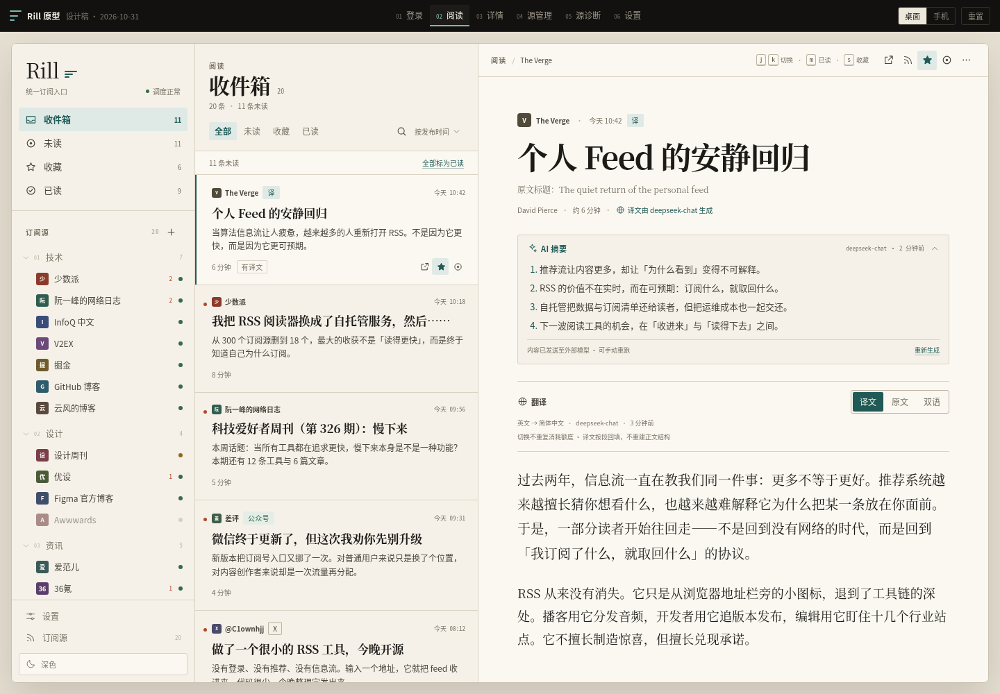
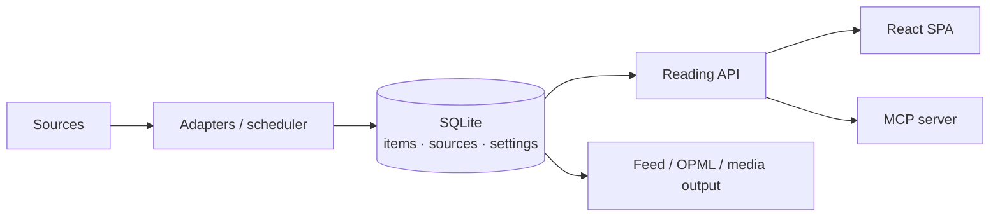

# Rill

**A rill** — many scattered feeds, gathered into one quiet stream.

[中文](README.md) · [Changelog](CHANGELOG.md) · [Source registry](docs/RSS-SOURCES.md)



Rill is a self-hosted unified subscription inbox. RSS / Atom / JSON Feed, X,
WeChat official accounts, Bluesky, RSSHub, Apple Podcasts and Xiaoyuzhou all
converge into one source manager, one reading experience and one output layer.
Full-text extraction, AI summaries, filter rules, scheduled reports and an MCP
server run in the same process.

A single Go binary plus SQLite serves both the API and the React SPA.

## Why "Rill"

A rill is a small stream running down a hillside — not a flood, and no dam.

- **Converge**: every platform has its own way of drawing water; Rill routes them into one channel.
- **Clear**: content is sanitized before storage, images are cached locally, duplicates fall back through `guid → link → content hash`.
- **Steady**: per-source schedules, conditional requests and adaptive polling; only genuinely new content flows in.
- **Portable**: every source can emit RSS 2.0 / Atom / JSON Feed, so the water keeps flowing downstream.

## Features

- **Source management**: URL recognition, feed discovery, nested folders, drag-and-drop, multi-select, source search, saved views.
- **Source coverage**: standard feeds, RSSHub, X, Bluesky, WeChat official accounts, Apple Podcasts, Xiaoyuzhou, podcast audio.
- **Reading**: three-pane and focus modes, read-later, notes with inline highlights, browser speech synthesis, cross-source duplicate merging, command palette.
- **Full text**: extract article bodies from summary-only feeds, automatically per source or on demand per article, with images registered in the media cache.
- **AI**: any OpenAI-compatible endpoint; per-source summaries and per-item translation, never triggered automatically by default.
- **Rules and automation**: keyword / regex filters, scheduled reports, Feishu and custom webhook delivery.
- **Interoperability**: per-source and site-wide RSS / Atom / JSON Feed, nested-folder OPML import/export, FTS5 search.
- **MCP**: `/mcp` over Streamable HTTP (SSE) with Bearer tokens, so external agents can read and write.
- **Security**: Lazycat OIDC authorization code + PKCE, CSRF protection, AES-256-GCM encrypted secrets, hashed tokens.
- **No telemetry**: nothing is reported to third parties.

## Supported sources

| Source | How it works | Status |
| --- | --- | --- |
| RSS 0.9x / 2.0, Atom 1.0, JSON Feed 1.1 | `gofeed` + ETag / Last-Modified conditional requests | Tested |
| RSSHub routes | `rsshub://` normalized to a public instance URL | Tested (public instances may return 403) |
| X / Twitter | FxTwitter public API, automatic FixupX fallback | Tested |
| Bluesky | Public `bsky.app` RSS | Tested |
| WeChat official accounts | BestBlogs public catalog first; WeRead QR login otherwise | Partial (on-device QR flow pending) |
| Apple Podcasts | iTunes Lookup → official feed | Tested |
| Xiaoyuzhou | `feed.xyzfm.space` first, SSR fallback | Tested |
| Podcasts / audio | enclosure detection, playback, speed and resume | Tested |
| Medium / Mastodon | Homepage URL normalization | Partial |

The Weibo channel was removed on 2026-11-08. Endpoints, auth, rate limits,
dedupe keys, fallbacks and test records for every source live in
[`docs/RSS-SOURCES.md`](docs/RSS-SOURCES.md); new sources must be registered
there first.

## Quick start

Requirements: Go 1.23+, Node.js 20+.

### Frontend (mock API, no backend needed)

```bash
cd web
npm install
cp .env.example .env.local   # VITE_USE_MOCK=true
npm run dev                  # http://127.0.0.1:5173
```

The mock simulates Lazycat OIDC: clicking "Sign in with Lazycat" opens a demo
session and never writes real credentials.

### Backend (built-in fake OIDC provider)

```bash
cd server
go run ./cmd/devoidc &       # 127.0.0.1:8091, local development only
RILL_OIDC_CLIENT_ID=dev \
RILL_OIDC_CLIENT_SECRET=dev \
RILL_OIDC_AUTH_URI=http://127.0.0.1:8091/authorize \
RILL_OIDC_TOKEN_URI=http://127.0.0.1:8091/token \
RILL_OIDC_USERINFO_URI=http://127.0.0.1:8091/userinfo \
RILL_DATA_DIR=./data \
RILL_CACHE_DIR=./cache \
go run ./cmd/rill            # 127.0.0.1:8080
```

In production, inject a real OIDC provider through the environment. The server
refuses to start when any OIDC variable is missing, so it never degrades into an
unauthenticated app. See [`server/README.md`](server/README.md) for the full
variable list.

### Checks

```bash
cd server && go test ./...
cd web && npm run typecheck && npm run test && npm run build
```

## Architecture



- Single-writer SQLite (WAL), versioned migrations with automatic backup.
- Same-domain fetches are serialized; the UA identifies the app; 304 responses do not create rows.
- The backend sanitizes HTML first; the frontend applies a second DOMPurify allowlist.
- Images are proxied and cached on demand; video is neither proxied nor downloaded.

See [`PDD.md`](PDD.md) for technical details and [`PRD.md`](PRD.md) for scope and
acceptance criteria.

## Documentation

| Document | Contents |
| --- | --- |
| [`PRD.md`](PRD.md) | Product requirements, priorities, acceptance and risks |
| [`PDD.md`](PDD.md) | Architecture, data model, adapters, security |
| [`docs/RSS-SOURCES.md`](docs/RSS-SOURCES.md) | How each source is implemented and tested |
| [`docs/DESIGN.md`](docs/DESIGN.md) | Visual and interaction specification |
| [`docs/DECISIONS.md`](docs/DECISIONS.md) | Confirmed and pending decisions |
| [`docs/PROGRESS.md`](docs/PROGRESS.md) | Delivery baseline, evidence and open items |
| [`DOCUMENT_MAP.md`](DOCUMENT_MAP.md) | Documentation map and sources of truth |
| [`web/README.md`](web/README.md) | Frontend setup, routes and conventions |
| [`server/README.md`](server/README.md) | Backend environment, endpoints and usage |

## Status and boundaries

This is an MVP. Local tests and request-level integration pass; standard feeds,
Bluesky, RSSHub, Apple Podcasts, Xiaoyuzhou and X have been tested against real
upstreams. On-device WeChat QR login, the real OIDC browser callback and parts
of the mobile UI are still pending acceptance. Unverified capabilities are never
documented as "verified".

## License

[GNU AGPL-3.0](LICENSE) © 2026 dnwwdwd

If you run a modified version as a network service, the AGPL requires you to
offer the corresponding source as well.
