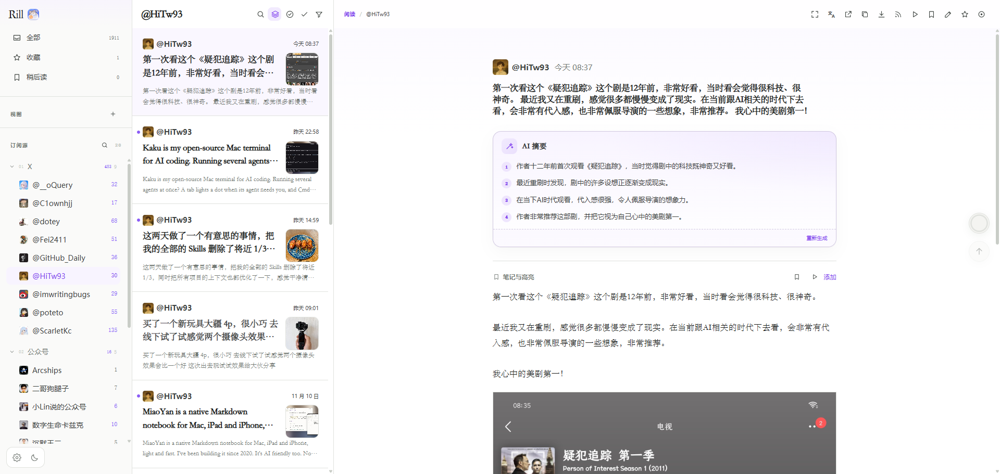
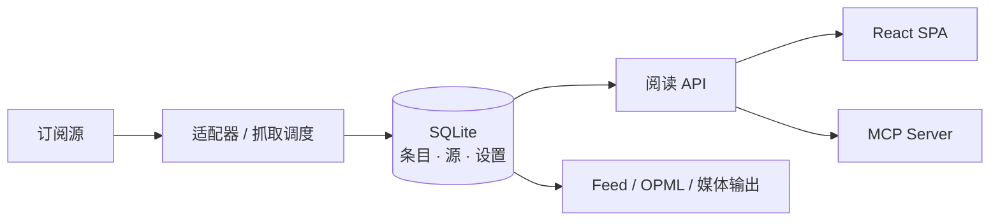

# Rill

**溪流** — 把分散的信息源，汇成一条安静的溪流。

[English](README.en.md) · [更新日志](CHANGELOG.md) · [订阅源实现登记](docs/RSS-SOURCES.md)



Rill 是一个自托管的统一订阅入口。标准 RSS / Atom / JSON Feed、X、微信公众号、
Bluesky、RSSHub、Apple Podcasts、小宇宙，收敛到同一套源管理、阅读与输出层；
全文抓取、AI 摘要、过滤规则、定时报告和 MCP 都在同一个进程里完成。

一个 Go 二进制 + SQLite 承载后端与前端静态产物，前端是 React SPA。

## 为什么叫 Rill

Rill 是山间细小的溪流：不是洪流，也不筑坝。

- **汇流**：RSS、社交平台、公众号、播客有各自的取水方式，Rill 把它们接到同一条河道。
- **清澈**：正文先清洗再入库，图片走本地缓存，重复条目按 `guid → link → 内容哈希` 去重。
- **缓缓流**：按源独立调度、条件请求、自适应轮询；只有真正的新内容才会流进来。
- **可导出**：每个源都能输出 RSS 2.0 / Atom / JSON Feed，水可以继续流向别处。

## 特性

- **统一源管理**：URL 自动识别、Feed 自动发现、多级文件夹、拖拽归类、批量多选、源搜索、保存视图。
- **订阅源覆盖**：标准 Feed、RSSHub、X、Bluesky、微信公众号、Apple Podcasts、小宇宙、播客音频。
- **阅读体验**：三栏 / 专注阅读、稍后读、笔记与内联高亮、浏览器朗读、跨源重复合并、命令面板。
- **全文抓取**：对只输出摘要的 Feed 提取正文，按源自动或按文章即时抓取，图片登记到媒体缓存。
- **AI 能力**：OpenAI 兼容接口；按源摘要、条目翻译，默认不自动触发。
- **规则与自动化**：关键字 / 正则过滤、定时报告、飞书与自定义 webhook 推送。
- **输出与互操作**：每源和全站 RSS / Atom / JSON Feed、嵌套分组 OPML 导入导出、FTS5 全文搜索。
- **MCP**：`/mcp` 以 Streamable HTTP（SSE）+ Bearer Token 暴露读取与写入工具，便于外部 Agent 接入。
- **安全**：懒猫 OIDC 授权码 + PKCE、CSRF、密钥 AES-256-GCM 加密、Token 哈希存储。
- **无遥测**：不向任何第三方上报使用数据。

## 支持的信息源

| 源 | 接入方式 | 状态 |
| --- | --- | --- |
| RSS 0.9x / 2.0、Atom 1.0、JSON Feed 1.1 | `gofeed` + ETag / Last-Modified 条件请求 | 已实测 |
| RSSHub 路由 | `rsshub://` 归一化为公共实例 URL | 已实测（公共实例可能 403） |
| X / Twitter | FxTwitter 公共 API，失败自动降级 FixupX | 已实测 |
| Bluesky | `bsky.app` 公开 RSS | 已实测 |
| 微信公众号 | BestBlogs 公开目录优先；未收录时微信读书扫码 | 部分验证（真机扫码待验收） |
| Apple Podcasts | iTunes Lookup → 官方 Feed | 已实测 |
| 小宇宙 | `feed.xyzfm.space` 优先，无 Feed 时页面 SSR | 已实测 |
| 播客 / 音频 | enclosure 识别、播放与倍速续播 | 已实测 |
| Medium / Mastodon | 主页链接归一化 | 部分验证 |

微博渠道已于 2026-11-08 移除。每个源的端点、鉴权、限流、去重键、降级方案与实测记录
见 [`docs/RSS-SOURCES.md`](docs/RSS-SOURCES.md)；新增源必须先在该文档登记。

## 快速开始

要求：Go 1.23+、Node.js 20+。

### 前端（mock 模式，无需后端）

```bash
cd web
npm install
cp .env.example .env.local   # VITE_USE_MOCK=true
npm run dev                  # http://127.0.0.1:5173
```

mock 模式模拟懒猫 OIDC：点击「使用懒猫账号登录」即进入演示会话，不写入真实凭据。

### 后端（内置假 OIDC 提供方）

```bash
cd server
go run ./cmd/devoidc &       # 127.0.0.1:8091，仅本地假提供方
RILL_OIDC_CLIENT_ID=dev \
RILL_OIDC_CLIENT_SECRET=dev \
RILL_OIDC_AUTH_URI=http://127.0.0.1:8091/authorize \
RILL_OIDC_TOKEN_URI=http://127.0.0.1:8091/token \
RILL_OIDC_USERINFO_URI=http://127.0.0.1:8091/userinfo \
RILL_DATA_DIR=./data \
RILL_CACHE_DIR=./cache \
go run ./cmd/rill            # 127.0.0.1:8080
```

生产模式通过环境变量注入真实 OIDC 端点；缺少任一 OIDC 变量时服务拒绝启动，
不会静默退化为无鉴权应用。完整变量表见 [`server/README.md`](server/README.md)。

### 校验

```bash
cd server && go test ./...
cd web && npm run typecheck && npm run test && npm run build
```

## 架构



- 单写连接 SQLite（WAL），逐版本自动迁移，迁移前自动备份。
- 抓取同域名串行，UA 带应用标识；304 不重复入库。
- 正文由后端清洗，前端再用 DOMPurify 做第二道白名单。
- 图片按需代理并本地缓存，视频不代理、不自动下载。

技术细节见 [`PDD.md`](PDD.md)；产品范围与验收见 [`PRD.md`](PRD.md)。

## 文档

| 文档 | 内容 |
| --- | --- |
| [`PRD.md`](PRD.md) | 产品需求、功能优先级、验收与风险 |
| [`PDD.md`](PDD.md) | 架构、数据模型、适配器、安全 |
| [`docs/RSS-SOURCES.md`](docs/RSS-SOURCES.md) | 每个源怎么实现、怎么降级、实测到什么程度 |
| [`docs/DESIGN.md`](docs/DESIGN.md) | 视觉与交互规范 |
| [`docs/DECISIONS.md`](docs/DECISIONS.md) | 已确认与待确认决策 |
| [`docs/PROGRESS.md`](docs/PROGRESS.md) | 交付基线、验证证据与未完成项 |
| [`DOCUMENT_MAP.md`](DOCUMENT_MAP.md) | 文档地图与现行正本 |
| [`web/README.md`](web/README.md) | 前端运行、路由与约定 |
| [`server/README.md`](server/README.md) | 后端环境变量、端点与运行 |

## 状态与边界

当前为 MVP：本地测试与请求联调通过；标准 Feed、Bluesky、RSSHub、Apple Podcasts、
小宇宙、X 已做真实源端到端实测；微信公众号真机扫码、真实 OIDC 浏览器回调与部分
移动端交互仍待验收。未验证的能力不会在文档中写成「已验证」。

## 许可证

[GNU AGPL-3.0](LICENSE) © 2026 dnwwdwd

如果你把它作为网络服务提供给别人使用，AGPL 要求你一并提供修改后的源码。
